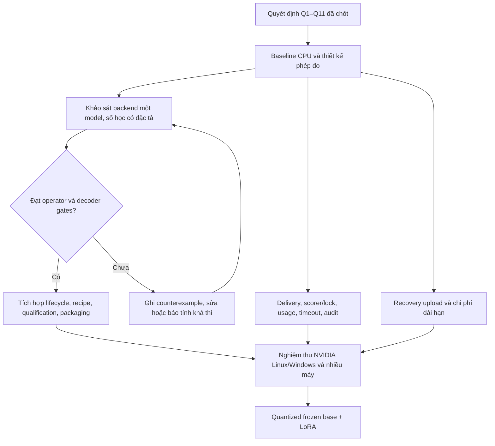

# Kế hoạch sửa các phát hiện human-review

Ngày: 24/10/2026. **Chủ dự án đã xác nhận bản tổng hợp và yêu cầu bắt đầu auto-run.**

Nguồn: [human-review.md](../human-review.md), [ghi chú review](OPEN-DECISIONS.md), mã nguồn
`c9997734f3ea2a40e4c6393b833d7d23677f4a95` tại [repo chính](../heteroes/).
Tài liệu này được tạo riêng; không sửa snapshot review cũ. Sau khi duyệt kế hoạch, chủ dự án cho phép
triển khai tự động, thử GPU và SSH tới 3060-thao. Không suy thành quyền deploy hay đổi approval/revocation thiết bị.
Theo dõi implementation tại [trạng thái trong repo](../heteroes/docs/HUMAN-REVIEW-IMPLEMENTATION.md).

## 1. Các quyết định chủ dự án đã chốt trong phiên này

| ID | Quyết định |
| --- | --- |
| D1 | Mỗi GPU chỉ giữ một bộ inference weights đầy đủ trong các process do HeteroES quản lý, gồm worker, coordinator validation, profiling và export/reload. Các role dùng chung runtime hoặc chạy lần lượt. |
| D2 | Cùng candidate và input phải sinh cùng từng token và cùng reward giữa các máy tham gia; không bắt buộc logits trung gian bằng từng bit. |
| D3 | Hỗ trợ nhiều loại máy/GPU là yêu cầu cốt lõi. Không giải quyết bằng cách chỉ cho GPU giống nhau cùng chạy. |
| D4 | Cho phép backend/recipe mới, có thể cho kết quả khác đường FP32 cũ. Bảo toàn định danh và khả năng replay của run lịch sử. |
| D5 | Thứ tự: một model FP16 với full/subset ES; tiếp theo quantized frozen base + ES trên LoRA; full-weight ES trên quantized model là nghiên cứu riêng. |
| D6 | Giữ snapshot CPU để exact restore. Snapshot chỉ theo trainable schema. |
| D7 | Tập trung NVIDIA; không đưa AMD/Intel vào phạm vi triển khai hiện tại. |
| D8 | Prototype bắt đầu bằng Qwen2.5-0.5B revision đã pin, sau đó mở thêm theo họ model/operator coverage. |
| D9 | Backend strict mới: audit lệch text thì dừng trước update tiếp theo, giữ bằng chứng; không đợi ba mismatch. Mismatch không xác định bên nào đúng. |
| D10 | Một lần tự phục hồi mỗi worker/run sau restore mismatch: ngừng nhận việc, báo lỗi bền vững, hủy model cũ, tải parent chuẩn, kiểm tra/probation rồi rejoin tại boundary. Lặp lỗi hoặc mismatch inference cần người vận hành. |
| D11 | Watchdog theo giai đoạn và tiến độ thực, cộng hard cap hữu hạn do researcher/operator cấu hình rõ. Heartbeat chỉ biểu thị còn liên lạc. |

Không suy D2 thành bằng chứng đã đạt tính đồng nhất. Backend mới chưa được triển khai hay nghiệm thu.
Không suy D4 thành quyền thay tùy ý thuật toán noise/update/ledger lịch sử.

Chính sách trước đó tiếp tục áp dụng: giữ oomd và khả năng sử dụng host; giữ dữ liệu cần replay/verify/download
đến khi chủ run xóa; không tự tăng hạn mức một lần coordinator recovery; bài nghiệm thu đĩa thật đầy vẫn hoãn.
Nguồn: [quyết định vận hành 23/10](../heteroes/docs/operations-decisions-2026-10-23.md).

## 2. Những điều đã xác minh, tách khỏi giả thuyết

- `eval/precision.py:28` tạo `copy.deepcopy(model).float()` trên device của live model và giữ suốt đời evaluator.
  `executor.py:218` perturb FP16, refresh toàn bộ shadow rồi forward và restore. Đây là hành vi mã nguồn.
- Với 494.032.768 unique parameters: FP16 = 988.065.536 B, FP32 = 1.976.131.072 B;
  tổng hai bộ GPU weights khoảng 2,97 GB / 2,76 GiB. CPU full snapshot thêm khoảng 0,99 GB.
  Đây là phép tính storage, **không phải peak VRAM/RAM đo được**.
- Subset/LoRA hiện vẫn deepcopy toàn inference model. Coordinator tracker cũng có shadow.
  Export/reload có đường load thêm model trên cùng device khi model cũ còn sống (`v3/tracker.py:128`).
- Một model FP16 là option có sẵn, nhưng bằng chứng cũ ghi nhận text/reward khác giữa GPU.
  FP32 và CPU margin guard hiện tại cũng không tạo bảo đảm mọi input/phần cứng.
- Backend quantized model chưa có contract/test tích hợp. Schema và ES helper hiện đòi FP16;
  LoRA loader cũng từ chối base parameter khác FP16. Noise v2 quantized không phải model quantization.
- `worker_api.py:241` giữ request lock xuyên scorer, ledger commit và usage; `v3/audit.py:112`
  thêm outer lock. Chưa có profiling để định lượng nghẽn thực tế.
- Result đã commit gửi lại vẫn có thể gọi scorer trước khi ledger trả ALREADY_COMMITTED.
  DB idempotency tồn tại; chi phí, lỗi hay tác dụng phụ của scorer không tự được chống lặp.
- Heartbeat context kết thúc sau evaluation, trước delivery và pending retries (`worker.py:268`).
  Failure report có transport retry nhưng chưa có durable local outbox nếu retry cạn.
- HTTP request body có giới hạn 1 MiB (`http_transport.py:53`); batch text lớn có thể bị 413.
- Generation timeout tính một lần; managed run thiếu speed history có sàn 1.800 giây.
  Heartbeat không gia hạn hard cap đó.
- Recovery point hard-link weights, không giữ một full model RAM cho mỗi generation.
  Upload single-object đọc cả object vào Python bytes và retry có thể hash lại nhiều GB mỗi vòng.
  Lỗi vòng rehash đã có bằng chứng lịch sử; nguyên nhân oomd vẫn là giả thuyết mạnh, chưa chứng minh.

## 3. Kết quả vòng grilling cuối và những gì phải giải bằng số đo

Chủ dự án đã trả lời đồng ý toàn bộ Q7–Q11. Các quyết định gốc của kế hoạch đã được chốt:

| Câu hỏi | Kết quả đã duyệt |
| --- | --- |
| Q7 | Một bộ inference weights trên mỗi GPU cho toàn bộ các role quản lý bởi HeteroES — D1. |
| Q8 | Qwen2.5-0.5B trước, mở rộng theo họ model — D8. |
| Q9 | Dừng trước update tiếp theo khi audit strict lệch text — D9. |
| Q10 | Phục hồi restore-only có giới hạn một lần mỗi worker/run — D10. |
| Q11 | Stage/progress watchdog và hard cap cấu hình rõ — D11. |

Các lựa chọn dưới đây được đưa vào milestone với đầu ra bắt buộc, thay vì tự coi là đã biết:

- W0/W1: operator graph/config chính xác, numerical reference và hướng kernel khả thi.
- W1/G3: workspace bound, context/batch range, slowdown/throughput chấp nhận được — đề xuất sau khi có baseline.
- W2: dùng chung GPU runtime hay phân pha các role; giải pháp phải thỏa D1 trong toàn lifecycle.
- W4: ngưỡng watchdog cụ thể theo profile và cách cấu hình rõ trên SDK/lab; không tự thay 30 phút bằng số đoán khác.
- W6: quantizer đầu tiên dựa vào kernel coverage, footprint và native Windows/Linux acceptance.

Ngưỡng hiệu năng cuối cùng, mở thêm họ model và chuyển default/triển khai là quyết định tại gate tương ứng,
với số đo và artifact cụ thể. Chúng không được suy thành đã đạt trong bản kế hoạch này.

## 4. Thứ tự công việc và các cổng nghiệm thu

Các nhánh độc lập có thể làm đồng thời nếu được giao nhân lực, nhưng đây không phải chỉ thị chạy GPU/SSH/deploy.
Không cần chờ nghiên cứu kernel hoàn tất mới sửa những lỗi delivery/retry đã có test tái hiện.

### W0 — Đặc tả và baseline

1. Ghi ADR mới cho single-model execution và strict output contract; giữ nguyên recipe/document lịch sử.
2. Thống nhất phạm vi model/config, greedy decoding, context lengths, batch/chunk và KV cache được hỗ trợ.
3. Lập bản đồ bộ nhớ theo role/process/GPU, cả startup, parent sync, candidate, validation, profile và export.
   Dùng receipts cũ và CPU cho baseline ban đầu; không tự chạy lại đường GPU hai model trái D1 để lấy baseline.
4. Bổ sung đo theo stage, có thể bật/tắt và có execution/attempt identity:
   - parent sync/replay, snapshot/hash, perturb, conversion nếu có, prefill, decode, restore và verify;
   - serialize/compress/hash, upload/download bytes, delivery/retry/ACK;
   - API lock queue/hold, scorer queue/compute, ledger commit và usage;
   - generation update, recovery capture, verify/upload, cleanup.
5. Phân biệt CPU wall time, GPU elapsed time và thời gian chờ. CUDA async không được làm phase timing sai;
   phép đo đồng bộ sâu chỉ bật trong profiling, rồi đo overhead của chính profiler.
6. Ghi allocated/reserved/process/device VRAM, CPU anonymous RSS, host/cgroup file cache, swap và PSI.
   Nếu không đo được chỉ số trên OS nào thì ghi unavailable, không điền 0.

Đầu ra: baseline matrix và trace schema, phân loại đo được/suy luận/chưa biết. Bằng chứng GPU chỉ thu khi có
ủy quyền cụ thể với cấu hình, thời lượng và công cụ phù hợp; giai đoạn hiện tại không chạy GPU.

### W1 — Chứng minh tính khả thi của backend một model

**Nguyên tắc:** chỉ một bộ trọng số inference đầy đủ trên GPU; FP32 workspace được phép nếu giới hạn theo tile/slab,
không materialize cả model FP32. CPU snapshot vẫn được phép. Giảm VRAM và tốc độ phải đo cả peak lúc load/convert.

Khảo sát hai họ thiết kế trước khi chốt implementation:

- FP16 storage, phép tính theo tile với FP32 operations và thứ tự reduction/casts được đặc tả;
- fixed-point/integer reference cho các operator khó bảo đảm trên vendor floating kernels.

Không cam kết dùng integer-only chỉ vì dễ mô tả tính đồng nhất: phải đo chất lượng số, tài nguyên và tốc độ.
Không yêu cầu backend mới cho cùng text với backend FP32 cũ; yêu cầu các implementation của backend mới cùng tuân đặc tả.

**G0 — Operator inventory đầy đủ:** embedding/tied head, linear/bias/residual, RMSNorm, RoPE,
attention/mask/scale/softmax, SiLU/gated MLP, casts, logits processors, KV cache, argmax/EOS/padding.
Phải chỉ rõ rounding, FMA/contraction, subnormals/FTZ, overflow/nonfinite, constants và tie-break token.
Phạm vi batch/prefill/decode cần có thứ tự phép tính nhất quán; không mặc định batch size 1 giải quyết cross-GPU.

**G1 — Operator reference:** known-answer vectors và oracle độc lập, đối chiếu bit ở chỗ contract quy định;
gồm ties, signed zero, tails/odd shapes, reduction dài, masks và giá trị biên. Giải thích vì sao implementation
thực hiện cùng thuật toán trên từng SM/OS/compiler. Corpus test thành công không thay thế lập luận số học.
Reference phải thực hiện đúng kiến trúc model. Đối chiếu sai số với phép tính độ chính xác cao và task outputs
để phát hiện backend xác định nhưng làm sai phép toán; không lấy tính xác định làm bằng chứng model còn đúng.

**G2 — Decoder:** so token IDs rồi text/reward, trên parent và perturbed candidates, prompt ngắn/dài,
EOS khác thời điểm, near-ties, cache growth, batching/compaction và đổi cách giao candidate.
Mục tiêu zero token/reward differences trong matrix đã xác định; ghi rõ giới hạn coverage.

**G3 — Resource và usefulness:** đo peak mọi phase; weights storage tiến về khoảng 2N bytes với FP16,
workspace có bound theo cấu hình. Tổng VRAM vẫn gồm KV cache, buffers, CUDA context và allocator reserve.
Báo tokens/s, candidate latency, generation latency, thời gian conversion và host-transfer nếu có.
Sau baseline/prototype mới đề xuất ngưỡng slowdown/throughput cho chủ dự án chọn.

Operator/config chưa hỗ trợ phải bị từ chối rõ. Không chạy fallback HF/cuBLAS/FlashAttention thông thường dưới cùng
identity strict. Không dùng seed, quantization, rounding logits hay margin guard làm bằng chứng thay cho contract.
Nếu chưa đạt, đầu ra là counterexample và lựa chọn tiếp theo; không hạ yêu cầu exactness để đóng milestone.

### W2 — Tích hợp runtime, model lifecycle và product

- Thêm định danh backend/operator contract version riêng; tách storage dtype, compute contract và decoder.
  Cách thêm field/version phải giữ nguyên nghĩa và hash của document lịch sử; không tự đặt tên format v4 trước ADR.
- Tích hợp `eval/precision.py`, `executor.py`, `study/evaluation.py`, `v3/model.py`, `v3/run.py`.
  Giữ canonical noise, FP16 perturb publication, ES accumulation order và exact snapshot restore khi không có ADR khác.
- Dùng cùng backend cho worker, audit, validation/test, checkpoint evaluation và export independent reload.
  Kiểm tra local coordinator+worker, profiling và export để tránh bản model GPU thứ hai ngoài executor.
  Thêm quyền sở hữu GPU giữa các role/run do HeteroES quản lý; phase chuyển giao phải giải phóng weights GPU cũ
  trước khi load bộ mới. CPU snapshot có RAM budget/provenance và không tích lũy qua generation.
- Cập nhật `v3/documents.py`, `v3/options.py`, `sdk.py`, `sdk_lab.py`, `v3/lab_cli.py`, backend request/validation
  và UI. Loại hard-code managed FP32 bằng capability kiểm tra được, không chỉ nới enum.
- Qualification/reference cache phải key theo backend/contract/config/quantization identity ngoài noise engine và model hash.
  Bằng chứng FP32 cũ không cấp tư cách cho backend mới. Admission là kiểm tra tương thích, không phải chứng minh mọi input.
- Package kernel sources/native assets/compiler requirements đúng Linux và native Windows;
  `refresh-worker-runtime.py` hiện chỉ gom `.py`, nên cần kiểm tra artifact thực sự được giao đến worker.
  CPU lab import/build không bị kéo phụ thuộc CUDA không cần thiết.

Gate: exception/OOM/cancel không để worker nhận candidate mới với weights sai; exact restore và replay hashes đạt;
không có hidden full-model allocation ở lifecycle đã cam kết; native packages chạy đúng backend đã khai báo.

### W3 — Delivery, lease, failure report và scorer idempotency

1. Giữ heartbeat từ lúc nhận lease qua compute, restore, delivery và pending retry đến terminal ACK/stale/rejection.
   Heartbeat phải có thể được phục vụ khi scorer đang chạy; chỉ kéo dài context mà giữ global scorer lock là chưa đủ.
2. Local outbox bền vững, giới hạn dung lượng và xác thực lineage cho result/failure report khi cần chịu process restart.
   Restore mismatch làm worker local ngừng nhận việc ngay; coordinator notification retry đến khi có ACK hoặc quyết định kết thúc.
3. Đường submit: xác thực và so committed payload trước khi gọi scorer; identical retry trả kết quả canonical có sẵn.
   Chunk/receipt metadata có quy tắc kiểm tra riêng, không để đổi payload canonical qua retry.
4. Tách short state checks/transaction khỏi scoring dài: validate/reserve hoặc singleflight theo attempt,
   score ngoài global lock, revalidate ownership/state rồi atomic commit text+reward.
   Lease bị reassigned trong lúc score thì kết quả cũ vẫn tuân stale-attempt rule.
5. Usage đi qua bounded queue/outbox với idempotent key; lỗi usage không đổi outcome canonical.
   UI phải phân biệt dữ liệu thiếu/partial. Không tạo queue tăng RAM vô hạn khi sink chậm.

Giữ coordinator authoritative scoring và texts làm ledger evidence theo ADR-008 đã được chốt trước đó.
Không chuyển sang worker tự gửi reward chỉ để giảm bandwidth. Không hứa scorer chỉ được gọi một lần xuyên mọi crash:
crash sau scoring nhưng trước durable commit vẫn có thể đòi chạy lại; tác dụng phụ bên ngoài cần contract riêng.
Text đồng nhất chỉ dẫn đến reward tái tính đồng nhất khi scorer cũng là hàm xác định với input/config đã pin.
Python scorer tùy ý có thể dùng random/time/network; hash code không chứng minh tính xác định. Giữ chính sách Python
đã được cho phép, nhưng phân biệt recorded reward/replay với re-scoring acceptance và báo rõ giới hạn của scorer.

Gate tests: mất response sau commit, duplicate đồng thời, scorer chậm/lỗi, worker restart, mạng mất,
heartbeat/lease khi score đang chạy, reassignment giữa validate và commit, failure report mất ACK,
usage sink down/full và outbox recovery. Chính xác một canonical commit, reward không bị ép về 0.

### W4 — Audit controls, watchdog và quarantine

- Expose `audit_rate` trong SDK/notebook, API và lab UI, gồm 0 để tắt; giữ default hiện tại 5%, range 0..1,
  pin cấu hình khi tạo run và ghi provenance. Mid-run thay đổi chỉ làm nếu được thiết kế riêng tại boundary.
- Phân biệt selected/completed/matched/mismatched/timed-out/skipped; không coi incomplete là matched.
  Theo D9, strict mismatch dừng trước update tiếp theo; không sửa reward đã commit hay rollback lịch sử đã công bố.
  Mismatch giữa hai worker chưa xác định worker nào sai; giữ cả hai execution receipts để chẩn đoán.
  Thiếu audit và audit thực sự khác text là hai trạng thái riêng; giữ cách tiếp tục kèm trạng thái incomplete hiện tại.
  Tắt audit hay thiếu worker kiểm tra phải được thể hiện rõ, không gắn nhãn đã hoàn thành mọi audit được chọn.
- Watchdog theo compute/sync/delivery/scoring/audit/update/recovery; phát hiện tiến độ có ý nghĩa,
  không chỉ request count hay heartbeat. Hard cap hữu hạn do researcher/operator khai báo/kiểm soát (Q11).
  Có monotonic clock và restart semantics rõ; live config không âm thầm kéo dài deadline vô hạn.
- Phân biệt lease expiry, exhausted attempts/grace, stage stall và generation hard cap.
  Test workload đầu tiên nặng, scorer chậm, network delay, worker chỉ heartbeat nhưng compute đứng.
- Restore quarantine khác inference/audit mismatch. Theo D10, state machine
  quarantined -> reloading -> selftest -> parent identity/restore verification -> probation -> boundary rejoin.
  Hạn mức một lần sửa tự động phải persist qua restart, không reset bằng service restart.
- Reconcile ledger quarantine, audit fault file và supervisor/lab quarantine; không chỉ xóa một cờ.
  Không thay trạng thái approved/revoked/contribution của thiết bị.
  Nếu không còn worker khỏe để hoàn tất generation và đạt boundary, ghi rõ run đang chờ phục hồi/can thiệp;
  không tự bỏ quy tắc boundary để tái nhập worker. Hard cap vẫn có hiệu lực. Tự sửa worker không bảo đảm
  mọi topology sẽ tự tiếp tục được, và không tự tăng hạn mức coordinator recovery.

### W5 — Payload, hash và recovery/lưu trữ dài hạn

- Đo JSON/text bytes thực, compressed bytes, hash time, wire time và coordinator decode/scorer cost theo workload.
  Body limit 1 MiB cần validation sớm hoặc protocol chunk/stream có bound và content hash toàn payload;
  không chỉ bỏ giới hạn. Nếu nén, bound cả kích thước sau giải nén.
- Profile hash theo mục đích: canonical weights/noise, transport integrity, recovery verify, source/dataset identity.
  Chỉ cache khi identity/immutability/invalidation rõ; không bỏ verification để lấy tốc độ.
- Recovery upload dùng bounded streaming/chunks, không `read()` toàn weights object. Retry backoff có state,
  ưu tiên điểm mới nhất đủ điều kiện, bảo vệ final point và dependencies cần resume.
- Verify cache gắn với immutable manifest và file identity được kiểm tra; thay đổi file hoặc restart bất định
  phải invalidation/reverify phù hợp. Remote integrity vẫn phải được kiểm tra trước READY.
- Đo ledger/usage backup, source/dataset rehash, retention và full-scan queries theo early/middle/late generations.
  Chỉ thêm indexes/batching/incremental logic khi query plan và trace chứng minh cần; SQLite backup consistency phải giữ.
- Giữ chính sách dữ liệu đã duyệt; không tự xóa artifact còn cần replay/result.
  Không hoán đổi storage location hay tắt oomd để che áp lực bộ nhớ.
- `_thresholds_v2.py`: ưu tiên giữ generated Python nếu packaging/import và số đo không cho thấy vấn đề;
  review generator, digest, endian/boundaries và oracle. Đổi container file không phải tối ưu numerical bắt buộc.

Gate: upload failure/full-storage giả lập không tạo buffer theo model size hoặc rehash storm; resume/replay từ point hợp lệ;
không phụ thuộc điểm đã prune; chi phí mỗi generation không tăng không giải thích được theo run length.
Nghiệm thu đĩa thật đầy vẫn hoãn theo quyết định trước; môi trường fault giả lập không được gọi là nghiệm thu đó.

### W6 — Quantized frozen base + LoRA

1. Chọn một quantization method/version sau feasibility spike; không gọi tất cả INT4 là cùng định dạng.
2. Pin packed weights, scales/zero-points/codebook/group layout, quantizer version và dequant arithmetic;
   cùng một artifact được xác minh trên các máy, không quantize tùy máy theo default khác nhau.
3. Schema chỉ chọn floating adapter parameters mà không bắt base packed integer phải là FP16.
   Adapter perturb/update/restore tiếp tục có oracle và identity riêng.
4. Base, adapters và từng operator kết hợp đi qua cùng strict execution contract;
   quantized storage không tự chứng minh forward exact.
5. Không tạo full dequantized FP16/FP32 base phụ trên GPU. Bound scratch/tile và KV-cache;
   kiểm tra peak cả load, adapter injection, candidate, validation và export/reload.
6. Qualification, package, recovery và export pin đầy đủ base+adapter+quantization identity;
   reloaded model sinh cùng token/reward với model đã chọn.

Gate: zero differences trong operator/decoder/hardware matrix; adapter hash chain/replay và exact restore đạt;
model size thực tế chạy được/VRAM/tốc độ được đo. Label rõ LoRA; không so như full-weight ES.
Full quantized ES chỉ có design note riêng cho search space/rounding/noise/update, không được đánh dấu đã hỗ trợ.

## 5. Ma trận kiểm chứng và bằng chứng

| Lớp | Kiểm tra cần có |
| --- | --- |
| CPU | Small Qwen2 fixture, operator known answers, document/golden identity, outbox/ledger/concurrency với fake clocks; mutation check trên scratch theo AGENTS. |
| NVIDIA | Khác SM/kiến trúc; mục tiêu khảo sát Turing/Ampere/Ada/Blackwell, ban đầu phần cứng có thể tiếp cận hợp lệ. Không có máy/bằng chứng thì ghi chưa nghiệm thu. |
| OS/package | Linux và native Windows, kernel/compiler/version identity; chạy packaged runtime, không chỉ source checkout. |
| Workload | Full/subset FP16; parent và candidate nhiều seed/sign/sigma; prompt/context/tokens khác nhau, batch/chunk permutations, EOS/near-tie/masks và failed paths. |
| Distributed | 1/2/3 máy khi có phần cứng; đổi assignment/retry không đổi tokens/rewards/child chain dưới recipe mới. CPU/GPU replay tách khỏi inference regeneration. |
| Performance | Ít nhất 3 repeats mỗi cell phù hợp, raw samples và p50/p95/uncertainty; so cùng model/recipe/workload, tách startup khỏi steady state và toàn run. |
| Long run | Run hệ thống đủ dài để so early/middle/late và tái hiện chi phí bookkeeping; 600-generation regression chỉ khi được cấp ngân sách GPU riêng. Không chạy để chứng minh ES learns. |
| Failure | Network loss/slow coordinator, duplicate ACK, scorer/usage failure, restart, stale lease, restore mismatch, storage upload failure, outbox/backpressure. |

Mỗi evidence folder mới có commit/config/build/hardware identities, raw receipts, cách lặp lại và mục
**What this does NOT show**. Giữ evidence/artifacts cũ bất biến. Báo riêng correctness, inference equality,
replay equality, memory, throughput và platform coverage; không dùng một nhãn PASS để đại diện tất cả.

Sau helper/behavior thay đổi, viết meaningful tests trước, mutation check scratch; chạy targeted tests rồi
required repo checks ở integration milestone. Không chạy full suites chỉ để lập kế hoạch.

## 6. Bao phủ từng ý human-review

| Ý review | Nhánh xử lý |
| --- | --- |
| Hai model FP16/FP32 | W0–W2; cả tracker/profile/export/local lifecycle, không chỉ executor |
| FP16/quantized đồng nhất nhiều máy | W1 gates, W2 qualification/package, W6 quantized LoRA |
| Coordinator nhận toàn bộ text/scoring nghẽn | W0 trace, W3 lock/scorer, W5 payload |
| Bandwidth và lock | W3/W5, có giới hạn payload/decompression/backpressure |
| Researcher chỉnh/tắt audit | W4, SDK/API/UI/provenance |
| Scorer/usage cost | W0/W3, canonical commit tách sidecar |
| Recovery điểm lưu weights, tăng dung lượng/bộ nhớ | W0/W5; phân biệt RAM snapshot, hard link, upload buffer và retention |
| Toàn bộ vòng đời candidate | W0/W3/W4; compute đến terminal delivery ACK |
| Scorer trước ALREADY_COMMITTED | W3, duplicate check trước scorer và race/crash tests |
| Heartbeat lúc gửi/chờ coordinator | W3; gắn với việc bỏ global scorer lock |
| Restore mismatch báo coordinator | W3 durable failure report + local stop, W4 reconciliation |
| Worker tự phục hồi sau quarantine | W4, theo D10 đã duyệt |
| Generation timeout | W4, theo D11 đã duyệt |
| Chi phí hash | W0/W5, không làm yếu canonical/integrity checks |
| Bảng thresholds nên là .py? | W5, giữ/đổi dựa generator/packaging/profile thay vì số dòng |

## 7. Rollout và điều kiện đóng

Các gói bàn giao dự kiến:

| Mốc | Bàn giao cụ thể | Điều kiện chuyển tiếp |
| --- | --- | --- |
| M0 | ADR, trace schema, inventory lifecycle/operator, CPU baseline và danh mục test tái hiện lỗi | Định danh và invariant rõ; không chỉnh số học trước khi có oracle |
| M1 | Prototype reference + kernel/decoder một-model trên Qwen đã pin; báo memory/throughput/counterexamples | G0–G3 đạt trên matrix có receipt; chưa đạt thì không đưa vào default |
| M2 | Delivery/outbox, duplicate fast path, scorer/usage concurrency, audit controls, watchdog và restore recovery | Fault/concurrency/restart tests cùng mutation checks đạt; có thể làm độc lập M1 |
| M3 | Streaming/backoff/verify-cache/retention dependencies và giảm chi phí dài hạn được đo | Corruption vẫn bị bắt; không tăng memory theo full upload; early/late cost có giải thích |
| M4 | Recipe/SDK/lab qualification, GPU ownership, tracker/export và runtime packaging tích hợp | Native Linux/Windows cùng nhiều kiến trúc NVIDIA có receipt; lịch sử/golden identities được giữ |
| M5 | Nghiệm thu end-to-end, fault/performance/long-run và bản release reviewable | Đủ các gate, báo phạm vi chưa nghiệm thu, có rollback; rollout quyết định riêng |
| M6 | Một quantized frozen-base format + LoRA qua toàn bộ lifecycle | Cùng strict contract, exact adapter replay/restore, không full dequantized shadow |

Thứ tự bắt đầu: M0, sau đó M1 là nhánh ưu tiên; M2/M3 có thể tiến độc lập sau khi đã có phép đo và test tái hiện.
Không ấn định tổng số ngày cho backend mới trước M1: khối lượng phụ thuộc operator coverage và kết quả tính khả thi.
Sau M0/M1 sẽ có ước lượng dựa trên phần việc thực tế, đồng thời trình ngưỡng hiệu năng cần chốt.

1. Q1–Q11 đã chốt. Chủ dự án xác nhận bản tổng hợp này thể hiện đúng shared understanding trước implementation,
   theo workflow grilling được gọi trong phiên. Xác nhận kế hoạch không tự cấp quyền GPU/SSH/deploy.
2. Commit theo milestone trên working branch; không thay deployed lab chỉ vì branch/test tiến lên.
3. Backend mới experimental đến khi G0–G3 và package/hardware gates đạt. Không tự chuyển default bằng kết quả fixture.
4. Migration/admission từ chối tổ hợp chưa hỗ trợ một cách rõ ràng; không fallback âm thầm hoặc sửa recipe run đang chạy.
5. Khi có artifact release cụ thể, trình bày config/capability/evidence/rollback để quyết định rollout.
   Không deploy, SSH, thay device state hoặc chạy GPU từ riêng tài liệu kế hoạch này.

Hoàn thành khi mỗi phát hiện có implementation hoặc quyết định hoãn được ghi rõ, test/receipt phù hợp,
memory lifecycle đạt giới hạn đã chốt, output contract có cơ sở và coverage trung thực, SDK/lab phản ánh đúng capability.
Nếu kernel exact còn chưa khả thi về tài nguyên/tốc độ, phải ghi đúng trạng thái đó; không gọi phương án đã sửa xong.

## 8. Nguồn kỹ thuật đã đối chiếu

- [PyTorch reproducibility](https://docs.pytorch.org/docs/2.14/notes/randomness.html): không bảo đảm
  tái lập xuyên platform/release chỉ bằng cùng seed hay các flags thông thường.
- [cuBLAS reproducibility](https://docs.nvidia.com/cuda/cublas/index.html#results-reproducibility):
  guarantee của vendor có điều kiện hardware/toolkit/streams, không thay cho contract xuyên kiến trúc.
- [Bitsandbytes compute dtype](https://huggingface.co/docs/transformers/main/quantization/bitsandbytes#compute-data-type):
  quantized weight storage tách với compute dtype; không suy INT4 storage thành integer-only inference.
- [Fused-upcast cross-architecture GEMM](https://arxiv.org/html/2609.25624v1): BF16 storage và FP32 register compute,
  linear outputs bitwise trên ba kiến trúc đã thử; vẫn có residual token divergence do non-GEMM attention.
  Không dùng kết quả này làm bằng chứng backend dự án đã exact.
- [I-LLM](https://arxiv.org/abs/2405.17849): nghiên cứu integer-only operators;
  không tự chứng minh chất lượng/tốc độ/tính đồng nhất của implementation sẽ chọn cho HeteroES.

