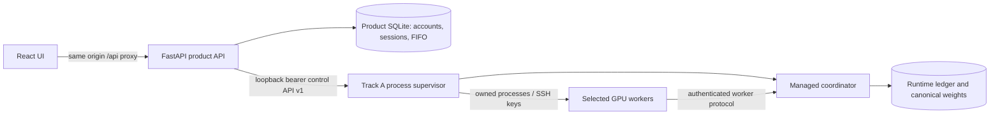

# Track A runtime integration

> Historical loopback/SSH integration. Phase 2 of the 2026-10-19 cleanup removed its launch scripts and
> gateway. Do not follow the setup commands below. See [the current handoff](refactor-handoff.md) and
> [the workstation lab guide](local-lab-operations.md) for the supported agent path.

Track B is pinned to `claude-design-ui` at
`bcdb71bb773f0239e91c73f915e97f3be96e69a6`. Its integration branch is
`feat/track-a-runtime-integration`. Track A is in the separate sibling worktree
`hetero-es-integration`, branch `feat/track-b-runtime-integration`, based on
`bb0ce420c21e10b3b9b13e3e494ce41453030420`. Neither branch is pushed or merged.

The existing UI design and explicit MSW demo remain available. Normal startup
uses real authentication, worker probes, ledger projections and checkpoints.

M1 extends this baseline with account approval, independent workspaces and
operational backup/restore on `feat/lab-operations-product` (Track B) and
`feat/lab-operations-control` (Track A). Current operator instructions are in
[lab-operations.md](lab-operations.md); the accepted later roadmap is
[lab-roadmap.md](lab-roadmap.md).



## Local setup

Use Node 24 and a separate Python 3.12 backend virtual environment. Preserve the
existing `ai` and `heteroes-match` environments and NVIDIA drivers.

```bash
python -m venv .venv-backend
.venv-backend/bin/pip install -r backend/requirements.lock.txt
npm --prefix frontend ci
python scripts/manage-integration.py init
```

Review `~/.config/heteroes-integration/config.json`. `init` never overwrites an
existing config or credentials. Configure the sibling Track A path, its Python
interpreter, pinned model cache, private LAN/Tailscale IP and SSH worker paths.
Credentials live in `~/.config/heteroes-integration/credentials.json` (mode 600,
parent directory mode 700). The product stores Argon2id password hashes and
hashes of opaque session tokens. Sessions expire after 12 hours; logout revokes
them. Sudo credentials, if provisioned by the owner, are not used by the services.

Deploy the isolated source bundle once to each reachable remote worker:

```bash
python scripts/manage-integration.py sync 3060
python scripts/manage-integration.py sync 1660s
```

This preserves each remote machine's existing repository and Python environment.
Wait for current runs to release the pool before deploying updated source.
On WSL, worker startup selects the mounted Windows CUDA and matching PTX JIT
libraries through a process-local `LD_LIBRARY_PATH`. It matches the active
`libnvidia-gpucomp.so` contents rather than choosing an old driver directory.
An ambiguous match fails preparation. No driver installation, package removal,
global shell configuration or existing Python package changes are involved.

Start and stop manually:

```bash
./start-integration.sh
./stop-integration.sh
python scripts/manage-integration.py status
```

The default UI URL is `http://100.110.165.40:5173`, reachable over the configured
private network. Port 8000 (product API) and 8766 (control API) bind to loopback.
Port 8765 binds to the configured private IP for workers. Vite proxies `/api`
to the backend; no browser-side runtime token or SSH key is required. This is a
manual, single-host, single-backend-process deployment; do not launch multiple
Uvicorn workers against the same queue. No public hosting or system autostart is
configured.

## Supported behavior

- The existing **HeteroES Lab** and accounts are preserved. M1 adds approved
  registration and independently administered workspaces. Workspace admins see
  and can cancel runs within their workspace; participants see their own runs,
  child objects, events and downloads. Platform administration is a separate
  persisted privilege. Inventory is scoped to enabled workspace assignments.
- Create/edit a draft, then submit its immutable configuration to a persistent
  FIFO queue. Exactly one active run owns the pool. A restart retains queue,
  sessions and run identity; accepted runtime submissions are idempotent.
- Qwen2.5-0.5B-Instruct is pinned to
  `7ae557604adf67be50417f59c2c2f167def9a775`. Built-in workloads and configured
  worker IDs come from Track A capabilities. Default: `arith16`, `hf_generate`,
  N=8, G=3, alpha=sigma=0.001, FP32 evaluation and canonical CPU noise.
- The configured execution policy is greedy and synchronous. Unsupported
  policies are rejected, not mapped to a different policy.
- Selecting a worker requests automatic local/SSH startup. A failed preflight
  is reported and the run can use other selected workers. No unselected worker
  is substituted. A launch whose ownership cannot be confirmed remains reserved.
- Cancellation prevents new leases. Active candidates finish evaluation and
  exact restore. An unrecorded generation is discarded; a write-ahead update
  already committed is completed or recovered before cancellation is finalized.
  The last complete checkpoint is retained. Terminal status and the next queued
  run wait for confirmed worker shutdown.
- The supervisor automatically retries a crashed coordinator once using the
  same configuration, run ID, ledger and weights. A second crash fails the run.
  A 30-minute deadline requests safe cancellation; draining can take additional
  time to finish an active candidate. Unknown shutdown keeps the pool reserved.
- Generations, candidates, attempts, rewards, worker timings and events are
  projections of actual runtime records. Candidate seeds are decimal strings
  to avoid JavaScript integer precision loss. Lease secrets are not exposed.
- Artifact downloads are authenticated and scoped to the experiment. A raw
  checkpoint `.bin` contains canonical FP16 weights and requires the Track A
  schema/hash loader; it is not a standalone Hugging Face model folder.
- A RESTORE_MISMATCH quarantines the worker across runs. Completing/cancelling a
  run and restarting services never clears it. Administrator investigation and
  an explicit private quarantine-registry update are required before reuse.

Pause/resume, changing workers during execution, arbitrary model/dataset upload,
asynchronous execution and dynamic pool grants remain unsupported. M1 provides
real member administration and configured GPU contribution. Validation/test
scores are not invented.

## Verification

```bash
.venv-backend/bin/python -m pytest backend/tests -q
npm --prefix frontend run build
npm --prefix frontend run lint
cd frontend
VITE_DATA_SOURCE=mock node scripts/check-local-demo.mjs
npx playwright install chromium
npm run test:integration
cd ..
python scripts/check-runtime-recovery.py
python scripts/check-two-gpu-integration.py
```

The browser and both Python acceptance commands require the running private
deployment and acquire GPUs.
The browser test requires an existing completed run, exercises Participant
create/start/cancel, and saves screenshots outside git. The recovery campaign
requires an idle pool, injects SIGKILL into only a verified owned coordinator,
checks one recovery, FIFO, queued cancellation, selected-worker fallback and a
checkpoint download SHA-256. It reports whether the 3060 actually participated.
The two-GPU campaign requires accepted ledger results from both the 5070 Ti and
Quang's 3060, all 24 candidates, three published generations, a downloaded
checkpoint hash and confirmed worker shutdown. Executor readiness alone does
not satisfy this check. To observe an existing run without acquiring a GPU:

```bash
cd frontend
HETEROES_OBSERVE_RUN_ID=<completed-run-id> npm run test:integration -- --observe-only
```

An explicit demo can be launched with `VITE_DATA_SOURCE=mock npm run dev` from
`frontend`; sample demo credentials are unrelated to real credentials. Real mode
unregisters an old MSW worker so it cannot silently intercept runtime requests.

## Evidence and limits

Runtime state, logs, weights and browser evidence are under
`~/.local/share/heteroes-integration/`, outside git. Service logs are in
`services/`. See `integration-validation.md` for this implementation's actual
checks and hardware acceptance status. A reachable GPU probe is not numerical
admission: workers still perform the existing recipe self-tests at startup.
The 1660S has a known intermittent hardware problem; this integration does not
reboot machines or change their drivers to hide it.
