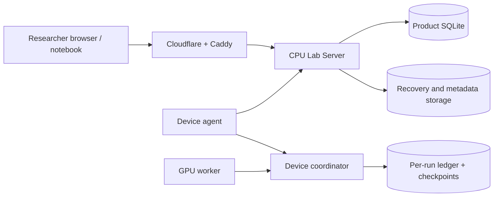

# Lab Server responsibilities and data ownership

Baseline: the modular monolith at `f07a509a`, before plan B's service split. This describes checked source code;
it is not an inspection of the live lab database. See the approved
[implementation plan](../plans/codex-2026-11-review-fixes-and-minicloud.md) for the target architecture.

## Tóm tắt tiếng Việt

Lab Server hiện là một tiến trình CPU đảm nhiệm nhiều vai trò: phục vụ web, API người dùng, cổng thiết bị, điều phối
hàng đợi, cấp quyền lưu trữ, sao lưu metadata, phát sự kiện SSE và thông báo. Việc chạy ES, sổ cái từng run và checkpoint
thuộc máy coordinator/worker. SQLite của Lab Server lưu trạng thái quản lý; các file lớn và bản sao lưu có nơi lưu riêng.
Phần B sẽ chia các vai trò thành service và bổ sung PostgreSQL, Keycloak, MinIO; bản desktop vẫn dùng chế độ gộp.

## B-Q1: current server roles

`python -m backend.server` boots a CPU-only FastAPI application. `backend/app.py:create_app` wires routes, local state
and background work into one process. A role here means a responsibility, not a separate deployed server.

| Responsibility | Current implementation | State / ownership |
| --- | --- | --- |
| Static web and downloads | `backend/app.py`, `backend/routes_web.py`, configured web/download directories | Web build and installer files |
| User REST API and local identity | `backend/routes_*.py`, `backend/app.py`, `backend/passwords.py`, `backend/store.py` | Users, hashed passwords, sessions, workspaces, experiments |
| Device control plane | `backend/devices.py`, `backend/agent_*.py`, device routes | Enrollment, polling, telemetry, commands, contribution, assignments |
| Scheduling | `Store.dispatch`, started by the application lifespan | Queue, reservations and assignment decisions in product metadata |
| Recovery and transfer control | `backend/recovery_storage.py`, `backend/local_storage.py`, transfer routes | Recovery inventory, signed transfer capabilities and verification |
| Metadata backups | `backend/metadata_backup.py:backup_loop` | SQLite backup snapshots and their uploaded metadata objects |
| Event streaming | `backend/live.py:LiveStreams`, SSE routes | In-memory connections, snapshots read from metadata |
| Notifications and operations | Notification and platform routes, store helpers | Notification records, administrative policy and audit data |

The packaged entrypoint hides CUDA through `CUDA_VISIBLE_DEVICES=''`. GPU execution is performed by device agents,
not by this HTTP process. A coordinator on a device owns its runtime ledger, applies the generation record and publishes
weights; workers evaluate candidates and restore their snapshots. The strict GPU product requires the coordinator's GPU
to be distinct from its workers' GPUs.

The local deployment has Caddy in front of the CPU application and a Cloudflare tunnel in front of public entrypoints
(`backend/deployment.py:caddyfile`, `scripts/local-lab.py`). Caddy limits public request bodies and denies bulk routes
that require LAN/Tailscale. Small, scoped public dataset uploads have their own size bound. Compute control and large
model/recovery transfers use different routes and permissions.

## B-Q2: where data and backups live

The paths below are configuration keys or paths relative to an owning private directory. No live storage path, token
or signing key needs to be copied into this document.

| Data | Location / setting | Owner and evidence in source |
| --- | --- | --- |
| Lab metadata | `productStateDirectory/product.sqlite` | `Store`; users, workspaces, runs, devices, reservations, assignments, telemetry, audit and policy. `backend/server.py:initialize` creates `state/product.sqlite`. |
| Run execution ledger | `<run-directory>/ledger.sqlite` on coordinator device | `heteroes.product.runner` opens `Ledger(..., enforce_chain=True)`. Includes candidate attempts/results, recorded updates and parent/child hashes. |
| Published weights, artifacts and checkpoints | The coordinator's private run directory and its recovery points | Runtime runner, publication helpers, product recovery modules. These are separate from product SQLite. |
| Recovery objects and uploaded datasets/models | `storageDirectory` with the local backend | `LocalBackend` and `RecoveryStorage`; product metadata tracks object identity and authorization. |
| Metadata backup objects | `metadataStorageDirectory`; per-backup object key `metadata/<point>/product.sqlite` | `metadata_backup.py` uses SQLite's backup API and uploads/verifies snapshots through the storage backend. Restore procedures must include required configuration and signing-key recovery. |
| Local storage signing key | Private server configuration root (`storage-signing.key`) | Created by server initialization; never stored in Git or printed. Metadata backup files alone do not replace this configuration. |
| Installers and download manifest | Configured downloads directory (`--downloads`, `HETEROES_DOWNLOADS_DIRECTORY`) | Packaged artifacts, independent of application metadata. |
| Research receipts, historical logs and artifacts | Git branch `evidence-archive` | [Evidence index](../EVIDENCE-INDEX.md); not the live application state or its backup. |

A product database backup does not contain model/recovery object bytes or a coordinator's live process memory. A
complete recovery procedure must restore metadata and its referenced objects, then resume a run from a verified recovery
point on the coordinator. The runtime's write-ahead generation record prevents silently recomputing a different update.

## Planned service boundaries

Plan B first separates API, business services, repositories and DB transactions, with compatibility imports while tests
stay green. It then deploys one codebase as `api`, `devices`, `storage` and `scheduler`; desktop keeps `all` and SQLite.
Cloud mode uses PostgreSQL transactions/advisory locks, Keycloak identity and S3/MinIO objects. This section is a target,
not a claim that the split has already shipped. B1 will add the complete route ownership and in-memory state inventory.
