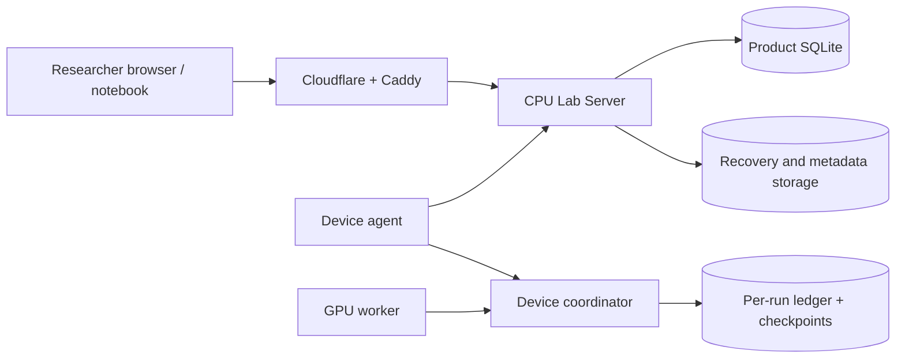

# Lab Server responsibilities and data ownership

Baseline: the modular monolith at `6ee47147`, before plan B's service split. This describes checked source code;
it is not an inspection of the live lab database. See the approved
[implementation plan](../plans/codex-2026-11-review-fixes-and-minicloud.md) for the target architecture.

## Tóm tắt tiếng Việt

Lab Server hiện là một tiến trình CPU đảm nhiệm nhiều vai trò: phục vụ web, API người dùng, cổng thiết bị, điều phối
hàng đợi, cấp quyền lưu trữ, sao lưu metadata, phát sự kiện SSE và thông báo. Việc chạy ES, sổ cái từng run và checkpoint
thuộc máy coordinator/worker. SQLite của Lab Server lưu trạng thái quản lý; các file lớn và bản sao lưu có nơi lưu riêng.
Phần B sẽ chia các vai trò thành service và bổ sung PostgreSQL, Keycloak, MinIO; bản desktop vẫn dùng chế độ gộp.

## B-Q1: current server roles

`python -m backend.server` boots a CPU-only FastAPI application. `backend/app.py:create_app` wires routes, local state
and background work into one process. A role here means a responsibility, not a separate deployed server.

| Responsibility                   | Current implementation                                                              | State / ownership                                                   |
| -------------------------------- | ----------------------------------------------------------------------------------- | ------------------------------------------------------------------- |
| Static web and downloads         | `backend/app.py`, `backend/routes_web.py`, configured web/download directories      | Web build and installer files                                       |
| User REST API and local identity | `backend/routes_*.py`, `backend/app.py`, `backend/passwords.py`, `backend/store.py` | Users, hashed passwords, sessions, workspaces, experiments          |
| Device control plane             | `backend/devices.py`, `backend/agent_*.py`, device routes                           | Enrollment, polling, telemetry, commands, contribution, assignments |
| Scheduling                       | `Store.dispatch`, started by the application lifespan                               | Queue, reservations and assignment decisions in product metadata    |
| Recovery and transfer control    | `backend/recovery_storage.py`, `backend/local_storage.py`, transfer routes          | Recovery inventory, signed transfer capabilities and verification   |
| Metadata backups                 | `backend/metadata_backup.py:backup_loop`                                            | SQLite backup snapshots and their uploaded metadata objects         |
| Event streaming                  | `backend/live.py:LiveStreams`, SSE routes                                           | In-memory connections, snapshots read from metadata                 |
| Notifications and operations     | Notification and platform routes, store helpers                                     | Notification records, administrative policy and audit data          |

The packaged entrypoint hides CUDA through `CUDA_VISIBLE_DEVICES=''`. GPU execution is performed by device agents,
not by this HTTP process. A coordinator on a device owns its runtime ledger, applies the generation record and publishes
weights; workers evaluate candidates and restore their snapshots. The strict GPU product requires the coordinator's GPU
to be distinct from its workers' GPUs.

The local deployment has Caddy in front of the CPU application and a Cloudflare tunnel in front of public entrypoints
(`backend/deployment.py:caddyfile`, `scripts/local-lab.py`). Caddy limits public request bodies and denies bulk routes
that require LAN/Tailscale. Small, scoped public dataset uploads have their own size bound. Compute control and large
model/recovery transfers use different routes and permissions.

## B-Q2: where data and backups live

The paths below are configuration keys or paths relative to an owning private directory. No live storage path, token
or signing key needs to be copied into this document.

| Data                                             | Location / setting                                                                  | Owner and evidence in source                                                                                                                                                               |
| ------------------------------------------------ | ----------------------------------------------------------------------------------- | ------------------------------------------------------------------------------------------------------------------------------------------------------------------------------------------ |
| Lab metadata                                     | `productStateDirectory/product.sqlite`                                              | `Store`; users, workspaces, runs, devices, reservations, assignments, telemetry, audit and policy. `backend/server.py:initialize` creates `state/product.sqlite`.                          |
| Run execution ledger                             | `<run-directory>/ledger.sqlite` on coordinator device                               | `heteroes.product.runner` opens `Ledger(..., enforce_chain=True)`. Includes candidate attempts/results, recorded updates and parent/child hashes.                                          |
| Published weights, artifacts and checkpoints     | The coordinator's private run directory and its recovery points                     | Runtime runner, publication helpers, product recovery modules. These are separate from product SQLite.                                                                                     |
| Recovery objects and uploaded datasets/models    | `storageDirectory` with the local backend                                           | `LocalBackend` and `RecoveryStorage`; product metadata tracks object identity and authorization.                                                                                           |
| Metadata backup objects                          | `metadataStorageDirectory`; per-backup object key `metadata/<point>/product.sqlite` | `metadata_backup.py` uses SQLite's backup API and uploads/verifies snapshots through the storage backend. Restore procedures must include required configuration and signing-key recovery. |
| Local storage signing key                        | Private server configuration root (`storage-signing.key`)                           | Created by server initialization; never stored in Git or printed. Metadata backup files alone do not replace this configuration.                                                           |
| Installers and download manifest                 | Configured downloads directory (`--downloads`, `HETEROES_DOWNLOADS_DIRECTORY`)      | Packaged artifacts, independent of application metadata.                                                                                                                                   |
| Research receipts, historical logs and artifacts | Git branch `evidence-archive`                                                       | [Evidence index](../EVIDENCE-INDEX.md); not the live application state or its backup.                                                                                                      |

A product database backup does not contain model/recovery object bytes or a coordinator's live process memory. A
complete recovery procedure must restore metadata and its referenced objects, then resume a run from a verified recovery
point on the coordinator. The runtime's write-ahead generation record prevents silently recomputing a different update.

## Implemented layering after B2 (2026-11-01)

At the end of B2, HTTP, business policy and persistence were separated while the combined service still used SQLite.
The B3 portability result is recorded below; process separation belongs to B4. Compatibility namespaces remain until B9.

| Responsibility                                                                    | Current owner                                                                    |
| --------------------------------------------------------------------------------- | -------------------------------------------------------------------------------- |
| HTTP routers, headers/cookies, SSE and static files                               | `backend/api/`                                                                   |
| Application construction, background lifetime and CLI                             | `backend/apps/factory.py`, `apps/server.py`, `apps/doctor.py`, `apps/monitor.py` |
| Business policy, access, domain operations, projections and thin Store facade     | `backend/services/`                                                              |
| Domain SQL                                                                        | `backend/repositories/`                                                          |
| SQLite initialization, transactions, schema, diagnostics and consistent snapshots | `backend/db/`                                                                    |
| Plain errors, configuration, request contracts, constants, clock and kernel lock  | `backend/core/`                                                                  |
| Filesystem object storage and signed capabilities                                 | `backend/storage/local_backend.py`; HTTP adapters remain in `api/`               |

The final B2 SQLite suite passes 502 tests; 62 original test files remain byte-identical. The full product contract
retains 111 method/path pairs plus two mounts. Every service imports in a fresh process with FastAPI, Starlette and
Torch blocked. Complete-tree guards keep direct SQL and snapshot execution inside repositories/DB.

Independent audits preserve all 278 unique SQL expression ASTs and the full fresh schema catalog, columns and indexes
(37 tables/177 columns). Sharing transaction/session helpers changes static SQL definitions from 358 to 350; it does
not add or remove a distinct expression. Final composition mutations pass 12/12 after closing the same-workspace list
owner coverage gap. Evidence: `2026-11-01-b2-composition` on `evidence-archive`.

This historical B2 result establishes source/CPU layering only. PostgreSQL and recursive runtime scanning are covered
by B3 below; separate replicas/leadership, OIDC, MinIO and recursive packaged apps remain later work.

## Database portability after B3 (2026-11-01)

The combined application now uses `backend/db/engine.py`: SQLAlchemy Core owns SQLite and PostgreSQL connections,
transactions, pools and result adaptation. psycopg 3 is an optional cloud dependency. Repository source uses named
parameters, explicit INSERT/public SELECT columns, portable ON CONFLICT, deliberate dialect JSON text projections and
explicit `_insert_order`; it does not translate SQLite DML at runtime. Positional binding compatibility remains for
existing direct callers. Empty positive IN lists use IN (NULL), since PostgreSQL rejects SQLite's accepted IN ().

SQLite keeps its original version-one migration and `PRAGMA user_version=1`. Additive migrations preserve old row
order and exact experiment bodies/snapshots; ten private order columns never enter public rows. PostgreSQL 17 uses
`db/postgres_schema.sql`, BIGINT/double precision and identity sequences. The logical schema is now 38 tables and
189 columns: the original 37/177, ten order columns and a two-column `schema_versions` table. Real-dialect inspection
compares columns/type affinity, primary keys and unique columns; behavioral tests enforce username and partial uniqueness.
Tests also detect 32-bit upload-size truncation and float4 timestamp rounding.

Outer writes acquire SQLite BEGIN IMMEDIATE or the PostgreSQL lab advisory transaction lock before any business read.
Nested calls reuse the outer connection; caught nested-scope errors force outer rollback. PostgreSQL statement savepoints
allow deliberate integrity-error recovery without losing the root serialization lock. Consistent SQLite backups use a
separate read connection; PostgreSQL pg_dump/restore and scheduler session leadership are B4 work.

Full backend: SQLite 528 tests; PostgreSQL invocation 538 (ten extra real-dialect engine/schema/repository cases), zero
skips, one existing dependency warning each. Its audit records 334 actual PostgreSQL product Stores and 39 SQLite Stores
in 35 explicitly marked file/migration/corruption/local-deployment contracts. No dummy SQLite files or silent PostgreSQL
fallbacks are used. Two independent product processes racing for one device and physical GPU grant exactly one assignment.
`scripts/check-backend-postgres.sh` reproduces the whole invocation on an owned PostgreSQL 17 container bound to a random
loopback port, writes its target audit/receipt and removes that container. Evidence: `2026-11-01-b3-portable-backend`.

B3 legitimately modernizes test SQL, marks SQLite file contracts, uses the dedicated snapshot API, strengthens the
runtime closure scanner to recursive production traversal and updates doctor instrumentation paths. Every baseline
assertion from the 70 B2 test modules is retained (SQL literal quoting normalized in the proof). This is separate from
B9's later import-only shim-removal proof. At the end of B3 the services still ran together; B4 progress is described below. B4–B10 and MiniCloud C remain unfinished.

## B4 service and scheduler core (2026-11-01)

The shared factory now accepts all/api/devices/storage/scheduler. An explicit registration facade partitions the actual
handlers before registration, while retaining dependency factories needed by other services. The route exporter
`python -m backend.apps.routes --json` constructs only throwaway local state. Four matching feature profiles cover web
and local object storage on/off; their disjoint product union matches all. The full profile retains API 67, devices 21,
storage 23 and two API-owned mounts. Health/readiness/metrics are three separately shared operational routes, registered
before the SPA. API/devices start no scheduler or metadata-backup loop; storage owns the backup loop.

Each role has `python -m backend.apps.<role>` with configurable host/port. Production split factories require PostgreSQL
and do not take the local SQLite writer descriptor; all+SQLite retains the existing descriptor/shutdown contract.
HETEROES_SERVICE and HETEROES_DATABASE_URL have initial support; the complete environment-only config belongs to B9.
PostgreSQL replicas persist/validate cluster identity and scheduler error types in settings. SQLite keeps configured
identity and process-local diagnostics. No error messages or bearer credentials enter the shared public health state.

A dedicated detached PostgreSQL session holds the scheduler advisory lock (a distinct key from lab writes). Heartbeats
never reacquire it and leave no idle transaction. Graceful exit explicitly unlocks and literally closes the session;
process death releases it automatically. Active/standby controllers dispatch only while owning it. Every business
transaction uses that physical session, preventing a lost leader from reconnecting on a new business session. Independent
operation commit/rollback boundaries remain intact: a failed job cannot erase completed or unrelated jobs (B-008).
Real PostgreSQL tests cover graceful takeover, process death, lost-session rollback, replica diagnostics/identity and
independent-job progress. Local all keeps the previous dispatch loop. Core acceptance: SQLite 541 / PostgreSQL 559, zero skips, mutation 16/16.
Evidence: `2026-11-01-b4-service-scheduler-core`.

This is not full B4 completion: PostgreSQL pg_dump-to-backup-storage and an isolated restore drill remain. Metrics here
establish route/liveness ownership; B7 adds the full instrumentation. OIDC, S3/MinIO, cloud config/packaging and B10/C
acceptance remain later work; nothing was deployed to the live lab.

## Planned service boundaries

Plan B first separates API, business services, repositories and DB transactions, with compatibility imports while tests
stay green. It then deploys one codebase as `api`, `devices`, `storage` and `scheduler`; desktop keeps `all` and SQLite.
Cloud mode uses PostgreSQL transactions/advisory locks, Keycloak identity and S3/MinIO objects. This section is a target,
not a claim that the split has already shipped. The B1 inventory below records complete route and state ownership.

## Pre-split inventory (prepared from source, 2026-11-01)

The isolated baseline app has 111 method/path pairs and two StaticFiles mounts. Its fully initialized product schema
has 37 tables and 177 columns. AST inspection finds 358 execute/executemany/executescript calls in 24 backend modules.
The baseline was constructed in a temporary directory with a temporary signing key, local object directory and SQLite
file. No live lab state or database was read. The complete baseline snapshots are retained with the B1 evidence.

| In-process state                                                     | Current source                                                       | Decision for split deployment                                                                                    | Recovery / replication rule                                                                                                                      |
| -------------------------------------------------------------------- | -------------------------------------------------------------------- | ---------------------------------------------------------------------------------------------------------------- | ------------------------------------------------------------------------------------------------------------------------------------------------ |
| Password/registration throttles                                      | app.py, throttle.py                                                  | Keycloak owns cloud password and registration throttling; keep existing counters in local all mode.              | OIDC disables the local credential endpoints. API replicas therefore hold no cloud credential throttle state.                                    |
| SSE active connection count and pacing                               | live.py LiveStreams                                                  | Keep per API replica as a resource limit.                                                                        | Timeline content comes from persisted run/snapshot data. Reconnecting to another replica rebuilds the stream; the counter is not business state. |
| One upload's file handle, digest, partial path and cancellation lock | local_storage.py _Upload                                             | Request-scoped state in the single storage service.                                                              | A lost request leaves no committed object; retry uses the signed grant. Local partial files are never treated as published objects.              |
| Storage signing key and path configuration                           | local_storage.py LocalBackend                                        | Single storage owner for local mode; S3 uses shared configured endpoints and credentials.                        | Keys/configuration survive process restarts in private mounted state. API services do not own upload file descriptors.                           |
| Recovery quota lock and pending verifier set                         | recovery_storage.py RecoveryStorage                                  | Keep in the single storage service; all upload/verify/delete routes belong there.                                | Durable point/object/ref status remains in DB. An interrupted verifier can be retried; the set only suppresses duplicate local threads.          |
| Recovery verification threads                                        | recovery_storage.py verify_background                                | Storage owns them.                                                                                               | A process restart cannot manufacture READY: object hashes and manifest publication remain the evidence of success.                               |
| Metadata backup timer/thread and local staging paths                 | metadata_backup.py, app.py lifespan                                  | Storage runs one loop; PostgreSQL mode uses pg_dump and the backup bucket.                                       | Completed manifests and backup status are durable. Restore is an explicit isolated operation, never an automatic overwrite.                      |
| Writer file descriptor                                               | writer_lock.py                                                       | Keep kernel lifetime lock for production all + SQLite. Split production services use PostgreSQL.                 | PostgreSQL serializes business writes with advisory transaction locks across all services.                                                       |
| Store.lock                                                           | store.py                                                             | Keep a process RLock for SQLite; DB layer owns transaction serialization.                                        | Reentrant calls share transaction ownership to avoid a second writer inside an open write. PostgreSQL uses one lab write lock key.               |
| Store.operation_lock and dispatch loop                               | store.py dispatch_once/dispatch                                      | Scheduler owns dispatch. One PostgreSQL session advisory leader lock admits the active scheduler; another waits. | Loss of the owning connection releases leadership. A new leader reconciles durable assignments/reservations before admitting work.               |
| Store.last_error                                                     | store.py                                                             | Persist scheduler diagnostics for other processes; retain the local facade for desktop compatibility.            | API replicas must not report their empty local cache as scheduler health.                                                                        |
| AgentRuntime references and configuration                            | devices.py, agent_commands.py, agent_polling.py, agent_scheduling.py | Each service may construct the facade; device commands, membership and reservations stay in DB.                  | No process-local device ownership is authoritative. Every state-changing operation uses the cross-process write transaction.                     |
| Model probe ownership                                                | model_qualification.py                                               | Retain probe jobs and device/physical reservations in DB.                                                        | HTTP process death does not release a GPU. Admission still requires observed ownership release.                                                  |
| Registry                                                             | study_registry.py                                                    | Database repository plus storage backend, without an authoritative memory cache.                                 | Asset and upload rows remain shared across replicas.                                                                                             |
| Notification cursor and dedupe                                       | notifications.py                                                     | Already persisted in settings/notifications; execute catch-up transactionally.                                   | Unique dedupe keys and the shared write transaction prevent duplicate projections across API replicas.                                           |

The proposed method/path ownership is API 67, devices 21 and storage 23. The storage exceptions below /device/ are
explicit: /device/recovery-points belongs to storage, while device study/model transfer grants belong to devices.
User-facing artifact routes, dataset upload/build routes and model upload/publish routes belong to storage. Ordinary
experiment, model inventory, qualification request and account/workspace routes belong to API. Web mounts and installer
manifest remain part of all for desktop compatibility and are served by web containers in MiniCloud.

Common health, readiness and metrics endpoints are operational routes on every process. Product-route union/equality
must be checked separately from these deliberately shared diagnostics. Scheduler exposes no product route.

## Baseline product route ownership proposal

Prepared from an isolated throwaway application with local storage and web enabled. No lab database or state was used.

| Method | Path                                                             | Current module                | Target owner |
| ------ | ---------------------------------------------------------------- | ----------------------------- | ------------ |
| POST   | `/api/v1/auth/login`                                             | `backend.routes_auth`         | api          |
| GET    | `/api/v1/auth/session`                                           | `backend.routes_auth`         | api          |
| POST   | `/api/v1/auth/logout`                                            | `backend.routes_auth`         | api          |
| GET    | `/api/v1/health`                                                 | `backend.routes_inventory`    | api          |
| GET    | `/api/v1/capabilities`                                           | `backend.routes_inventory`    | api          |
| GET    | `/api/v1/resources`                                              | `backend.routes_inventory`    | api          |
| GET    | `/api/v1/models`                                                 | `backend.routes_inventory`    | api          |
| GET    | `/api/v1/workers`                                                | `backend.routes_inventory`    | api          |
| GET    | `/api/v1/workers/{worker_id}`                                    | `backend.routes_inventory`    | api          |
| GET    | `/api/v1/datasets`                                               | `backend.routes_inventory`    | api          |
| GET    | `/api/v1/experiments`                                            | `backend.routes_experiments`  | api          |
| POST   | `/api/v1/experiments`                                            | `backend.routes_experiments`  | api          |
| GET    | `/api/v1/experiments/{run_id}`                                   | `backend.routes_experiments`  | api          |
| GET    | `/api/v1/experiments/{run_id}/timeline`                          | `backend.routes_experiments`  | api          |
| GET    | `/api/v1/experiments/{run_id}/stream`                            | `backend.routes_experiments`  | api          |
| PATCH  | `/api/v1/experiments/{run_id}`                                   | `backend.routes_experiments`  | api          |
| POST   | `/api/v1/experiments/{run_id}/submit`                            | `backend.routes_experiments`  | api          |
| POST   | `/api/v1/experiments/{run_id}/cancel`                            | `backend.routes_experiments`  | api          |
| DELETE | `/api/v1/experiments/{run_id}`                                   | `backend.routes_experiments`  | api          |
| POST   | `/api/v1/experiments/{run_id}/pause`                             | `backend.routes_experiments`  | api          |
| POST   | `/api/v1/experiments/{run_id}/resume`                            | `backend.routes_experiments`  | api          |
| PATCH  | `/api/v1/experiments/{run_id}/backup-policy`                     | `backend.routes_experiments`  | api          |
| POST   | `/api/v1/experiments/{run_id}/workers`                           | `backend.routes_experiments`  | api          |
| GET    | `/api/v1/experiments/{run_id}/generations`                       | `backend.routes_history`      | api          |
| GET    | `/api/v1/experiments/{run_id}/generations/{generation_id}`       | `backend.routes_history`      | api          |
| GET    | `/api/v1/generations/{generation_id}/candidates`                 | `backend.routes_history`      | api          |
| GET    | `/api/v1/candidates/{candidate_id}`                              | `backend.routes_history`      | api          |
| GET    | `/api/v1/attempts/{attempt_id}`                                  | `backend.routes_history`      | api          |
| GET    | `/api/v1/events`                                                 | `backend.routes_history`      | api          |
| GET    | `/api/v1/artifacts`                                              | `backend.routes_history`      | storage      |
| GET    | `/api/v1/artifacts/{artifact_id}/download`                       | `backend.routes_history`      | storage      |
| GET    | `/api/v1/audit`                                                  | `backend.routes_history`      | api          |
| POST   | `/api/v1/auth/register`                                          | `backend.routes_accounts`     | api          |
| PATCH  | `/api/v1/profile`                                                | `backend.routes_accounts`     | api          |
| POST   | `/api/v1/auth/password`                                          | `backend.routes_accounts`     | api          |
| POST   | `/api/v1/auth/revoke-other-sessions`                             | `backend.routes_accounts`     | api          |
| POST   | `/api/v1/workspaces`                                             | `backend.routes_workspaces`   | api          |
| POST   | `/api/v1/workspaces/{workspace_id}/invitations`                  | `backend.routes_workspaces`   | api          |
| PATCH  | `/api/v1/workspaces/{workspace_id}/listing`                      | `backend.routes_workspaces`   | api          |
| PATCH  | `/api/v1/workspaces/{workspace_id}/default-coordinator`          | `backend.routes_workspaces`   | api          |
| GET    | `/api/v1/listed-workspaces`                                      | `backend.routes_workspaces`   | api          |
| POST   | `/api/v1/workspaces/{workspace_id}/join-requests`                | `backend.routes_workspaces`   | api          |
| GET    | `/api/v1/workspaces/{workspace_id}/join-requests`                | `backend.routes_workspaces`   | api          |
| POST   | `/api/v1/workspaces/{workspace_id}/join-requests/{request_id}`   | `backend.routes_workspaces`   | api          |
| GET    | `/api/v1/my-invitations`                                         | `backend.routes_workspaces`   | api          |
| POST   | `/api/v1/my-invitations/{invitation_id}/accept`                  | `backend.routes_workspaces`   | api          |
| PATCH  | `/api/v1/workspaces/{workspace_id}/members/{user_id}`            | `backend.routes_workspaces`   | api          |
| DELETE | `/api/v1/workspaces/{workspace_id}/members/{user_id}`            | `backend.routes_workspaces`   | api          |
| GET    | `/api/v1/queue`                                                  | `backend.routes_workspaces`   | api          |
| GET    | `/api/v1/platform/users`                                         | `backend.routes_operations`   | api          |
| PATCH  | `/api/v1/platform/users/{user_id}`                               | `backend.routes_operations`   | api          |
| POST   | `/api/v1/platform/users/{user_id}/revoke-sessions`               | `backend.routes_operations`   | api          |
| GET    | `/api/v1/platform/audit`                                         | `backend.routes_operations`   | api          |
| GET    | `/api/v1/platform/operations`                                    | `backend.routes_operations`   | api          |
| POST   | `/api/v1/platform/maintenance/resume`                            | `backend.routes_operations`   | api          |
| GET    | `/api/v1/experiment-templates`                                   | `backend.templates`           | api          |
| POST   | `/api/v1/experiment-templates`                                   | `backend.templates`           | api          |
| DELETE | `/api/v1/experiment-templates/{template_id}`                     | `backend.templates`           | api          |
| GET    | `/api/v1/notifications`                                          | `backend.notifications`       | api          |
| POST   | `/api/v1/notifications/read`                                     | `backend.notifications`       | api          |
| POST   | `/api/v1/devices/pairing-codes`                                  | `backend.devices`             | devices      |
| POST   | `/api/v1/device/enroll`                                          | `backend.devices`             | devices      |
| GET    | `/api/v1/devices`                                                | `backend.devices`             | devices      |
| PATCH  | `/api/v1/devices/{device_id}/endpoints`                          | `backend.devices`             | devices      |
| PATCH  | `/api/v1/devices/{device_id}/configuration`                      | `backend.devices`             | devices      |
| PATCH  | `/api/v1/device/qualification`                                   | `backend.devices`             | devices      |
| GET    | `/api/v1/platform/devices`                                       | `backend.devices`             | devices      |
| PATCH  | `/api/v1/platform/devices/{device_id}`                           | `backend.devices`             | devices      |
| DELETE | `/api/v1/platform/devices/{device_id}`                           | `backend.devices`             | devices      |
| PATCH  | `/api/v1/devices/{device_id}`                                    | `backend.devices`             | devices      |
| DELETE | `/api/v1/devices/{device_id}`                                    | `backend.devices`             | devices      |
| POST   | `/api/v1/devices/{device_id}/contribution`                       | `backend.devices`             | devices      |
| PATCH  | `/api/v1/devices/{device_id}/contribution`                       | `backend.devices`             | devices      |
| POST   | `/api/v1/device/contribution`                                    | `backend.devices`             | devices      |
| PATCH  | `/api/v1/device/name`                                            | `backend.devices`             | devices      |
| DELETE | `/api/v1/device`                                                 | `backend.devices`             | devices      |
| GET    | `/api/v1/device/summary`                                         | `backend.devices`             | devices      |
| POST   | `/api/v1/device/poll`                                            | `backend.devices`             | devices      |
| POST   | `/api/v1/device/worker-command`                                  | `backend.devices`             | devices      |
| POST   | `/api/v1/datasets/import`                                        | `backend.study_registry`      | api          |
| GET    | `/api/v1/platform/dataset-limits`                                | `backend.study_registry`      | api          |
| PUT    | `/api/v1/platform/dataset-limits`                                | `backend.study_registry`      | api          |
| POST   | `/api/v1/datasets/upload-plan`                                   | `backend.study_registry`      | storage      |
| POST   | `/api/v1/datasets/uploads/{upload_id}/build`                     | `backend.study_registry`      | storage      |
| POST   | `/api/v1/models/register`                                        | `backend.study_registry`      | api          |
| POST   | `/api/v1/models/{asset_id}/upload-plan`                          | `backend.study_registry`      | storage      |
| POST   | `/api/v1/models/{asset_id}/publish`                              | `backend.study_registry`      | storage      |
| POST   | `/api/v1/device/study-transfer`                                  | `backend.study_registry`      | devices      |
| POST   | `/api/v1/models/{asset_id}/qualifications`                       | `backend.model_qualification` | api          |
| GET    | `/api/v1/models/{asset_id}/qualifications`                       | `backend.model_qualification` | api          |
| POST   | `/api/v1/models/{asset_id}/qualifications/{job_id}/cancel`       | `backend.model_qualification` | api          |
| POST   | `/api/v1/device/model-transfer`                                  | `backend.model_qualification` | devices      |
| POST   | `/api/v1/device/recovery-points`                                 | `backend.recovery_storage`    | storage      |
| POST   | `/api/v1/device/recovery-points/complete-object`                 | `backend.recovery_storage`    | storage      |
| POST   | `/api/v1/device/recovery-points/{point_id}/verify`               | `backend.recovery_storage`    | storage      |
| GET    | `/api/v1/device/recovery-points/{point_id}`                      | `backend.recovery_storage`    | storage      |
| DELETE | `/api/v1/device/recovery-points/{point_id}`                      | `backend.recovery_storage`    | storage      |
| POST   | `/api/v1/experiments/{run_id}/recovery-import`                   | `backend.recovery_storage`    | storage      |
| POST   | `/api/v1/experiments/{run_id}/recovery-import/complete-object`   | `backend.recovery_storage`    | storage      |
| POST   | `/api/v1/experiments/{run_id}/recovery-import/{point_id}/verify` | `backend.recovery_storage`    | storage      |
| GET    | `/api/v1/experiments/{run_id}/recovery-points`                   | `backend.recovery_storage`    | storage      |
| POST   | `/api/v1/recovery-points/{point_id}/download-plan`               | `backend.recovery_storage`    | storage      |
| DELETE | `/api/v1/recovery-points/{point_id}`                             | `backend.recovery_storage`    | storage      |
| POST   | `/api/v1/artifacts/{artifact_id}/download-ticket`                | `backend.recovery_storage`    | storage      |
| GET    | `/api/v1/cloud-downloads/{ticket_digest}`                        | `backend.recovery_storage`    | storage      |
| PUT    | `/api/v1/local-storage/{token}`                                  | `backend.local_storage`       | storage      |
| PUT    | `/api/v1/public-upload/{token}`                                  | `backend.local_storage`       | storage      |
| GET    | `/api/v1/public-study/{token}`                                   | `backend.local_storage`       | storage      |
| GET    | `/api/v1/local-storage/{token}`                                  | `backend.local_storage`       | storage      |
| mount  | `/assets`                                                        | `StaticFiles`                 | api          |
| GET    | `/downloads/manifest.json`                                       | `backend.routes_web`          | api          |
| mount  | `/downloads`                                                     | `StaticFiles`                 | api          |
| GET    | `/{route:path}`                                                  | `backend.routes_web`          | api          |
