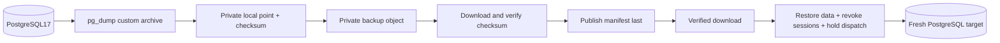

# PostgreSQL metadata backup and restore

The storage service owns the hourly metadata backup loop. SQLite keeps its existing `product.sqlite` snapshot path.
PostgreSQL17 uses a custom-format `product.pgdump`, with PostgreSQL17 `pg_dump`, `pg_restore` and `psql` tools. Cloud
images must provide those clients; the desktop SQLite profile never invokes them.

A point is staged below `productStateDirectory/metadata-backups/<point>/`, with private directory/file permissions.
Its manifest records SHA-256, size, schema, format and tool version. Credentials stay in a private libpq environment;
URLs/passwords never become command arguments or public error messages. Ambient PG service/password-file settings do
not select another database. The source schema is selected explicitly; `pg_dump` supplies a consistent snapshot while
ordinary work continues. The archive includes private application state and must stay in private storage.



The object is uploaded and read back before its manifest is published. A quota/network/checksum failure records PENDING
and retains the local archive. The newest 24 points are kept; retention uses each manifest's payload key so SQLite and
PostgreSQL points can coexist. No model/recovery object bytes or Keycloak database are included in this metadata dump.
Those resources need their own persistent state/backup plan.

Set `HETEROES_PG_DUMP`, `HETEROES_PG_RESTORE`, `HETEROES_PSQL` when the PostgreSQL17 clients are outside PATH. The test
runner extracts matching Linux clients/libraries from its owned PostgreSQL17 container into scratch space. It changes
no host packages or Conda environment. Cloud Python dependencies are pinned separately in `requirements-cloud.lock.txt`.

For restoration, download the archive and its manifest into private local storage, prepare a fresh empty target database,
and load its URL through a private environment file. The target application's search path must select the manifest's
`schemaName` (normally `public`). The command takes file paths and an environment-variable name, never a connection URL:

```bash
# The private file supplies HETEROES_DATABASE_URL for the fresh target, not the running source database.
set -a
. /path/to/private/restore-target.env
set +a
.venv-backend/bin/python scripts/restore-postgres-metadata.py \
  --database /path/to/private/product.pgdump \
  --manifest /path/to/private/manifest.json
```

`--target-env` selects another environment-variable name if needed. Restore rejects invalid metadata/checksums and a
nonempty target, including user schemas whose names start with `pg` without the reserved `pg_` prefix. A dedicated lab
write lock prevents another cooperating application process from initializing the empty target during restoration.

`pg_restore` prepares SQL in private temporary files. Only its pre-data CREATE SCHEMA statement is made idempotent for
an already-existing empty public schema; COPY data is not rewritten. `psql --single-transaction` with ON_ERROR_STOP
restores data and validates agent/schema identity, deletes sessions/download tickets and enables dispatch hold in the
same transaction. A validation failure rolls everything back. Reservations, device identities and experiment evidence
remain intact; an offline former coordinator is never permission to reuse its GPU. Success prints a small safe receipt;
failure prints only an error type. Temporary SQL is deleted in either case.

The B4 drill used a fresh PostgreSQL17 database and the real MinIO `heteroes-backups` bucket: upload, read-back checksum,
download and a fresh restore, with unknown reservations retained, sessions revoked and dispatch held. A real object
corruption test kept PENDING/local data and published no manifest. The SDK adapter in that test performs real S3 calls;
production S3 backend/factory integration belongs to B6. This does not constitute deployment or GPU acceptance.

The old official MinIO image could not be fetched. The test image was built from the pinned upstream release commit
`9e49d5e7a648f00e26f2246f4dc28e6b07f8c84a` (`RELEASE.2025-10-15T17-29-55Z`). The evidence records source archive,
Dockerfile, base-image digests, image ID, runtime version and successful health probe. Reuse this reviewed build recipe
for MiniCloud; do not substitute an unverified mirror. Source and client semantics:
[MinIO release](https://github.com/minio/minio/releases/tag/RELEASE.2025-10-15T17-29-55Z),
[pg_dump17](https://www.postgresql.org/docs/17/app-pgdump.html),
[pg_restore17](https://www.postgresql.org/docs/17/app-pgrestore.html).
