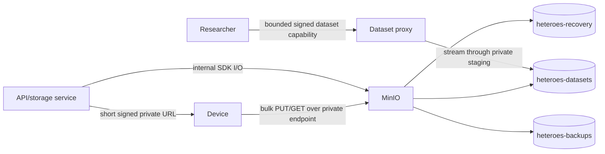

# S3/MinIO storage and private transfers

`storageMode: "local"` retains the filesystem backend. `"s3"` selects `backend/storage/s3_backend.py` through the same
application factory. boto3 stays a lazy cloud dependency. The private factory config contains an `s3` mapping; B9 owns
the environment-only overlay. Never put actual credentials in source, logs or evidence.

```json
{
  "endpointUrl": "http://minio:9000",
  "deviceEndpointUrl": "http://100.64.0.10:19000",
  "region": "us-east-1",
  "accessKeyId": "<private configuration>",
  "secretAccessKey": "<private configuration>",
  "buckets": {
    "recovery": "heteroes-recovery",
    "datasets": "heteroes-datasets",
    "backups": "heteroes-backups"
  },
  "stagingDirectory": "/state/storage-staging",
  "signingKeyFile": "/state/storage-signing.key"
}
```

Both credentials must be explicit and nonempty. Server I/O uses the internal endpoint; HTTP is allowed for internal
Docker names/private addresses. Public internal endpoints require HTTPS. The separate device origin uses the existing
numeric private/LAN/Tailscale rule, including for HTTPS. A public hostname cannot become a bulk endpoint. SDK clients
use SigV4, path-style addressing, explicit region, bounded timeouts/retries and no environment proxies. Buckets are
explicit/distinct and must already exist; the MiniCloud bootstrap creates them. No R2 account-confirmation or request
class allowances apply. Quota counts bytes across the three buckets, including uploaded multipart parts.



The default backend purpose stores recovery objects/manifests and uploaded model files in the recovery bucket.
`for_purpose("datasets")` keeps the same object-key format in a distinct dataset bucket. Dataset import, upload/build
and frozen dataset transfer explicitly select that purpose; model publication/probe transfers keep recovery. Metadata
keys always select the backup bucket and cannot be accessed through the dataset view. A hash present in a frozen run
is authorized against that run/epoch/device before its URL is issued. Dataset URLs and model URLs therefore select the
correct bucket even though both use `objects/<sha256>` keys.

Uploads up to64 MiB use a signed PUT; larger uploads use64 MiB multipart parts with a bounded final part. Plans sign
content length and expire after15 minutes; downloads expire after60 seconds. The runtime's shared HTTP client refuses
redirects for signed URLs. Incomplete parts count toward quota; completion/abort use the internal SDK. Missing uploads
can be aborted repeatedly. SDK file publication streams a file body from disk and checks an optional expected SHA
before sending it. Read streams close their response body.

A device's staging PUT URL can be reused during its lifetime. Services hash/size-check the uploaded version, then copy
it to its content-addressed key with `CopySourceIfMatch` binding the observed ETag. A changed upload cannot publish the
verified object. The staging key is deleted only after the conditional copy succeeds. A verified manifest is published
last. Existing schema/byte quotas and recovery authorization remain the owners of business policy; this adapter does
not bypass them. This is product-level verified publication, not S3 Object Lock against a privileged bucket operator.

Only the dataset view issues a public upload URL for files up to64 MiB. The public API verifies the bucket-scoped HMAC,
method, key purpose, expiry and exact signed Content-Length before reading bytes. It checks staging free space, writes
a unique private temporary file with streaming length/hash checks, sends it to MinIO and deletes scratch in success,
failure or cancellation cleanup. It never buffers the full request into RAM. Public GET capabilities read only dataset
object keys and recheck the actual response size before streaming. Model/recovery/metadata objects have no public proxy
URL. Reserved `/api/v1/local-storage/*` routes return the private-transfer policy in S3 mode; S3 bulk uses its own private
endpoint. Gateways must preserve the existing private-bulk and public64-MiB rules.

Proxy capabilities derive a key from the shared private signing key and the actual dataset bucket name. They survive
replica/restart when the key file and configuration are shared; a capability from another bucket is rejected. API and
storage roles must see that same key. Temporary dataset builds use private local staging while source/final bytes live
in MinIO. The filesystem backend keeps its original layout, including support for both metadata `product.sqlite` and
`product.pgdump` payload names. S3 clients close after background threads stop during application shutdown.

The production `S3Backend` PostgreSQL drill uploads a real custom-format dump into the configured backup bucket,
downloads it, verifies SHA and restores into a fresh database. Sessions are revoked, reservations retained and dispatch
held. It complements B4's SDK-adapter drill. Backup/restore semantics and CLI are in
[PostgreSQL metadata backup](postgres-metadata-backup.md). Dumps and backup URLs remain private.

Verification combines generated configuration contracts with actual MinIO SDK/worker-style HTTP, local disk, product
model/dataset APIs, frozen transfer authorization, exact service-route partition and real PostgreSQL restore. The S3
route union remains111 product pairs with the original API/devices/storage ownership. Test buckets have unique owned
names and are removed with their own objects/unfinished uploads. No unrelated bucket/container is cleaned.

An initial mutation removing the first private-origin check is equivalent: the capability signer independently applies
the same private-origin rule before SDK clients exist. A separate probe verifies that second guard. An initial upload
length mutant survived because a short-body test also failed at final byte-count validation. The independent regression
now supplies a complete valid body with the wrong Content-Length, isolating the header guard. Neither intermediate
result is counted as a killed mutant. Full matrix/mutation receipts are in the evidence index.

These checks exercise isolated CPU/API/database/storage fixtures. Device test helpers supply CPU test profiles; they
prove authorization and storage routing, not GPU computation. Actual MiniCloud deployment, Keycloak integration, GPU
runs and multi-container failover remain C/B10. The live lab is not deployed or modified by these checks.

Primary APIs checked against the installed SDK and real MinIO:
[presigned URLs](https://docs.aws.amazon.com/boto3/latest/reference/services/s3/client/generate_presigned_url.html),
[conditional copy](https://docs.aws.amazon.com/boto3/latest/reference/services/s3/client/copy_object.html),
[botocore client settings](https://docs.aws.amazon.com/botocore/latest/reference/config.html).
