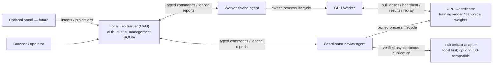

# Local-first architecture proposal and repository audit

Date: 2026-10-12. Status: architecture review; no new implementation in this
review step. The owner supplied local-first/self-hosted/cloud-optional as the
desired direction and requested an audit and proposal before further coding.
The owner explicitly retains decision authority. ADR details and the roadmap
below are PROPOSED choices, not approved decisions or completed capabilities.

The standalone [Claude review handoff](local-first-claude-handoff.md) includes
the task, current working-tree identity, evidence limits and open decisions.

## Recommendation

Build the first release around the **existing Local Lab Server**, running on a
CPU process with management SQLite. Keep the coordinator's training ledger and
canonical weights where they are. Qualify one standalone LAN lab end to end,
including offline provisioning and restore, before adding any hosted service.
Remote access and object storage remain replaceable, optional adapters.

The architecture handoff at core commit
`bb0ce420c21e10b3b9b13e3e494ce41453030420` is historical. It correctly describes
the research compute protocol but predates device identity and the product layer.
Do not recreate a control plane because that handoff says one is absent.

## Audit scope and evidence rules

| Track | Active checkout | HEAD at audit | Branch |
| --- | --- | --- | --- |
| A, runtime | `../hetero-es-m3-runtime` | `d5bbedb` | `feat/local-lab-completion` |
| B, product | this checkout | `023967c` | `feat/local-lab-completion` |

Both worktrees contain uncommitted continuation changes. HEAD alone does not
identify the audited source. [Audit receipt](evidence/2026-10-12-local-first/audit.json)
records source hashes and check results. Nothing has been pushed/merged/tagged.
Public GitHub readers cannot see these local changes.

In this document, **code** means a mechanism exists in the inspected tree;
**measured** means a dated test/run records the stated behavior; **proposed** means
a recommendation; **pending** means the relevant acceptance has not happened.
CPU fixtures, one-host GPU runs and older Windows evidence are not interchangeable.

| Area | Code/evidence | Actual limit |
| --- | --- | --- |
| Numerical ES, ledger, leases, replay/recovery | Track A core and historical cross-machine records | Trusted workers; full model replica per worker, no VRAM pooling |
| CPU management | `backend/app.py`, `store.py`, `devices.py`; M1/M2 browser and migration evidence | Local deployment accepted in slices; no hosted portal |
| Lab users/workspaces and resource policy | `backend/lab.py`, scoped API checks, owner/admin permissions | Workspaces in one installation are not federated independent lab tenants |
| Device identity | Single-use pairing, token digests, approval/revoke, boot-scoped ON, per-assignment compute grants | Legacy research CLI still supports shared tokens; product path binds authenticated worker identity |
| Scheduling | Explicit coordinator, atomic physical reservations, eligible FIFO and epoch fences | Simultaneous disjoint multi-job hardware gate remains pending |
| Multi-GPU experiment | M2 recorded 20/6/10 accepted candidates on three devices; final hash matched a single-GPU baseline | One distributed experiment, not simultaneous independent jobs or a scaling study |
| Management outage | M2 recorded an API outage of 40.055 seconds; generations progressed and state reconciled | Does not prove every launch/recovery/drain partition case |
| CPU Server and local storage | Desktop bootstrap, built same-origin UI/API, local signed transfers/CAS; new headless entrypoint in working tree | Fresh full offline installation still pending |
| Quick Tunnel separation | [Live receipt](evidence/2026-10-12-local-portability/quick-live-r1.json): Web/compute HTTPS, missing credential rejection, alias binding, public bulk denial, private Range bytes | CPU transport probe; no GPU workload in that receipt; not long-term availability evidence |
| GPU boundary resume and v2 export | Private `20261012-r2` standalone GPU receipt: resumed weights/rewards/update records matched baseline; v2 contexts and independent HF reload passed | One 5070 Ti host, direct core harness; packaged product, Windows v2 and other models not accepted |
| Windows | Historical native RTX 3060 v1 trial; new detail collector source/fixtures | New build/native collector and v2/coordinator support remain pending |
| S3/R2 | Existing adapter, scoped grants, verification, quota/retention and stub tests | No actual R2/S3 deployment acceptance |
| AWS/domain | Deployment helpers and owner-owned `heteroes.site` | No EC2/Named Tunnel/domain cutover in this review; no cloud prerequisite |

Historical proof and its limits are recorded in
[M2 implementation](m2-implementation.md),
[local progress](local-lab-progress.md) and
[monitoring evidence](evidence/2026-10-11-monitoring/README.md).
Preserve earlier negative learning findings; this architecture audit makes no
learning-gain, speedup, malicious-worker robustness or production-scale claim.

## Deployment modes and trade-offs

| Mode | Management authority | Required infrastructure | Trade-off and acceptance |
| --- | --- | --- | --- |
| A: Standalone Lab | One Local Lab Server | Existing workstation or CPU server; LAN; provisioned dependencies/model/data; local disks | Low operational dependency. Its host must be awake for management. Qualify offline provisioning and full workflow |
| B: Distributed Lab | The same Local Lab Server | A reachable lab API/coordinator; operator-selected HTTPS/VPN/gateway; a verified bulk path | Adds WAN latency, URL/certificate and connectivity failures. Qualify transport/faults separately; no worker cloud account required |
| C: Optional Hosted Portal | Each lab keeps local authority; portal federates views/intents | Local servers plus an optional shared hosted service | Useful only when multiple labs need it. Adds tenant isolation, identity mapping, delivery/reconciliation and upgrade work; defer |

Ten labs may operate ten local installations with no rented VPS. A shared portal,
if later useful, may run on a single suitable hosting target; capacity and costs
need separate measurement. Buying a domain or having cloud credit does not make
those services a runtime dependency.

For Mode B, a worker behind CGNAT needs outgoing connections; it does not need an
incoming worker port. Quick Tunnel control plus replay is useful, but replay has
a bounded chain and can require full-sync fallback. With the current private-
bulk policy, a remote worker needs LAN/VPN reachability for that fallback. Do not
advertise tunnel-only remote contribution as universally self-sufficient.

## Proposed module boundaries

One physical device may fill coordinator and worker roles within a single owned
assignment. This is not permission for two independent jobs to reserve that card.

| Component | Current source | Proposed boundary |
| --- | --- | --- |
| Web/API and authorization | `backend/app.py`, `lab.py` | CPU-only user commands, read projections, artifact authorization |
| Queue/assignment control | `backend/store.py`, `devices.py` | One local authority for durable intent, policy, assignment epochs and reservations |
| Device agent | A `product/agent.py`, `desktop_bridge.py` | Durable command adoption, boot ON/OFF, process identity, reports/outbox |
| Local supervisor | A `product/gateway.py`, `runner.py` | Start/preparation/drain/recovery orchestration; never manufacture accepted candidate results |
| Compute correctness | A `coordinator.py`, `worker_api.py`, `ledger/`, numerical modules | Candidates, attempts, accepted updates and canonical model lineage |
| Worker transport | A `http_transport.py`, `worker_runtime.py`, `replay.py` | Direct coordinator control/replay and configured bulk transport |
| Artifacts/recovery | B `local_storage.py`, `cloud_storage.py`; A `product/recovery.py` | Consistent runtime checkpoints, immutable bytes and manifest-last READY |
| Packaging | B `backend/server.py`, `desktop/`, `scripts/` | Desktop or headless entrypoint, independent runtimes and verified offline assets |
| Future federation | No current implementation | Portal intent inbox and lab projection adapter; no cloud SDK in numerical code |

Do not introduce a new runtime service solely to rename these existing pieces.
Use shared contracts and explicit boundaries; decompose files only when a concrete
change or test requires it.

## State and API contracts

Detailed authority is proposed in
[ADR-005](../../hetero-es-m3-runtime/docs/adr/ADR-005-state-and-lifecycle-authority.md).

- Management SQLite owns the user's request, queue, selected devices, assignment
  epoch and physical reservations.
- Coordinator ledger/verified weights own accepted candidates, update coefficients
  and canonical parent/child model versions.
- Local agent/supervisor owns evidence of actual process existence and shutdown.
- Management reports the combined product lifecycle; a portal would cache it.
  `COMPLETED` numerics and “resources released” are different facts.

Existing interfaces to keep:

| Interface | Contract |
| --- | --- |
| Experiment create/edit/submit | Validate local membership/model/worker eligibility; edits stop after submission; queue durably |
| Cancel/pause/resume | Persist intent; cooperative exact restore/drain; verified generation barrier; resume same run with fresh epoch/grants |
| Pairing/enrollment/approval/contribution | One-use enrollment, private device token, separate approval, current-boot owner ON |
| Device poll/worker-command | Typed commands, dedupe/acks, assignment and epoch checks; stale reports cannot release GPU ownership |
| `/v1/job`, leases, heartbeats, results, failures | Worker pull, authenticated alias/attempt ownership; infra failure is a typed error, not zero reward |
| Updates/models transfer | Canonical replay records and fully hashed weights; separate public control/private bulk origins |
| Backup/artifact publication | Runtime snapshot boundaries, consistent SQLite backup, object verification and final manifest |

Proposed future portal envelopes are specified in ADR-005; they are not routes
implemented today. Local permissions continue to apply even to portal requests.

## Answers to the handoff's eleven questions

1. **Separate or integrated process?** Separate CPU Lab Server and GPU runtime,
   optionally launched on the same workstation. This already matches the product.
2. **SQLite or PostgreSQL?** Retain management SQLite and one API process for the
   MVP. WAL/transactions and atomic reservations are already used. Reconsider
   hosted management DB needs when portal load/availability is measured.
3. **Submit/cancel/resume safely?** Keep typed durable commands, frozen run config,
   assignment epochs, exact restore/drain and runtime-owned checkpoints. Add
   lifecycle partition acceptance, rather than rewriting the training protocol.
4. **Two different hosts?** Device agents pull from the management API and report
   durable state. Workers talk to the coordinator directly. Neither requires SSH
   for runtime dispatch.
5. **Who owns RUNNING/FAILED/etc.?** Runtime supervisor/agent supplies lifecycle
   evidence; ledger supplies numerical facts; the lab server derives fenced
   product status. Unreachable or stale observations are not proof of failure/death.
6. **Enrollment MVP?** Existing local account -> one-use pairing -> numerical
   self-test -> administrator approval -> boot-scoped explicit owner ON.
7. **Upgrade deployment mode?** Preserve identity, schemas, config and API contracts;
   attach network/storage/federation adapters after idle preflight. No compulsory
   reinstall or new numerical recipe just to change a URL.
8. **Local versus hosted roles?** Keep platform admin distinct from workspace
   membership; current workspace checks stay local. Portal operator/lab operator
   identity mapping is future work, not automatic access to lab weights/results.
9. **Consistent backup?** Runtime generation barriers plus immutable content and
   manifests; complete site relocation uses maintenance/idle snapshots. Include
   model/data dependencies, hold restore and reconcile authority before dispatch.
10. **How many coordinators?** Accept one experiment/coordinator first. Retain
    explicit selection and existing disjoint-resource implementation; qualify
    concurrent independent jobs afterward. No automatic active-run failover.
11. **Version compatibility?** Publish independent API/runtime-profile/recipe/noise/
    ledger/management-schema/backup version checks. Unknown/unsupported combinations
    fail before launch. See ADR-007 for the migration/rollback boundary.

## Risks found by the audit

| ID | Finding | Required mitigation/gate |
| --- | --- | --- |
| R1 | Old handoffs describe missing control/identity and mandatory AWS acceptance | Date/supersession banners and this current code/evidence inventory |
| R2 | Standalone runtime is cloud-independent, but fresh installers fetch dependencies/models | A verified offline bundle and an empty-cache/no-Internet install test |
| R3 | Worker lifecycle commands still pass through the lab API | Partition tests before/after preparation, during recovery and during drain; preserve unknown ownership |
| R4 | Copying SQLite does not fence a still-active previous controller | One active controller per lab identity; held relocation; reconcile agents and resources before resume |
| R5 | v2 recovery configuration references dataset/model files outside the point | Complete verified local object inventory and offline restore onto a fresh path |
| R6 | New source is uncommitted and not a complete released package | Review working diff, fix red checks, establish a versioned release/source manifest and native acceptance |
| R7 | Capability additions and additive schemas can break strict older binaries | Explicit version matrix and N/N-1 rollout/unsupported downgrade tests |
| R8 | Current temporary public controls depend on a private bulk path | Preflight reachability and clear failure behavior; qualify alternative transports separately |
| R9 | Workspace isolation and per-device tokens are insufficient proof of multi-lab or malicious-worker isolation | Defer portal/public volunteer claims; specify lab identities and trust boundaries first |

## Dependency-ordered implementation plan

No runtime code is changed by this proposal. Use the existing spec -> behavioral
tests -> vertical slice -> review -> measured evidence workflow for each ticket.
This is a workflow pattern, not a claim that an installed Matt Pocock plugin was invoked.

| Ticket | Objective / scope | Main files/modules | Dependencies | Acceptance and test plan | Main risk |
| --- | --- | --- | --- | --- | --- |
| LF-0: architecture review | Review this audit and ADR-004..007; preserve current work and evidence; owner decides | This document, ADRs, MASTER/STATUS/handoffs | None | Classify code/measured/proposed; source hashes; record active services and pending checks | Mistaking old or dirty-source claims for a release or an approved design |
| LF-1: shipping baseline | Review paused source; resolve known red checks; define version and configuration contract; document LAN-only startup | B server/deployment/config/monitoring; A agent/bind/qualification; release helpers | LF-0 decisions | CPU service with GPU hidden; no tunnel/cloud requirement; same-origin UI; identity preservation; numerical v1 goldens; all required checks pass | Strict legacy clients and source drift |
| LF-2: offline Standalone MVP | Offline bundle/cache import, one local coordinator/worker, core v1 workflow and complete backup inventory | B desktop setup/download/profile/build/server; A qualification/runtime/recovery; local storage | LF-1 | Empty cache + no outbound network; login/enroll/approve/ON; queued job; exact baseline; pause/resume; offline artifact/backup access; corrupt/missing assets rejected | Runtime/model dependency availability and native-platform differences |
| LF-3: lifecycle and relocation | Exercise Lab Server partition matrix and restore onto a new host/path with previous controller stopped | B store/devices/backup/restore; A agent/gateway/runner/recovery; fault harness | LF-2 | API lost before launch, after assignment, mid-candidate, between generations, during cancel/pause/drain and recovery; no double execution/release; event reconciliation; held fresh restore and rollback | Ownership uncertainty; mixing snapshot times/lineages |
| LF-4: Distributed Lab | Qualify an operator-selected HTTPS/VPN route and private bulk fallback using the same contracts | Existing transport/proxy/helpers, endpoint preflight and desktop address update | LF-2 plus LF-3 release/reconcile safety | Public credential rejection; worker alias binding; interrupted Range/hash transfer; replay/full-sync fallback; URL rotation; actual remote-worker run; native walkthrough | WAN failures and bulk reachability |
| LF-5: expansion | Resume M4 disjoint hardware and M5 model/data qualifications from reviewed source | Current M4/M5 modules and evidence harnesses | Stable local MVP; compatibility decisions | Independent GPU ownership, extra-model qualification, v2 reproducibility/export and held-out metrics; no inferred learning gain | Borrowed hardware and widening numerical/platform matrix |
| LF-6: optional portal | Separate requirements/design spike only when multiple labs need it | New federation boundary and portal product | Demonstrated local autonomy and real multi-lab demand | Tenant isolation, intent dedupe/local acceptance, stale projection, portal outage; local operations continue | Two competing authorities and cross-lab identity/credential leaks |

The first reviewable MVP is LF-1..3 with the pinned Qwen Recipe v1 on a supported
local configuration. Native Windows user acceptance remains a release gate for
claims covering Windows; it need not block Linux-only internal validation.
M5 continuation is preserved and parked while the standalone architecture is
settled. Its experimental features do not become prerequisites for the MVP.

Keep the 8 November core freeze, 15 November result freeze and 20 November 2026
submission targets. A hosted portal is future scope; cloud availability and a
positive learning result are not local architecture acceptance criteria.

## Decisions ready for owner review

The ADRs propose: independent CPU Lab Server with SQLite; one local authority;
LAN-first operation with an offline provisioning bundle; optional adapters;
federation of local lab servers rather than replacing them with a mandatory portal.

Remaining choices to settle before their dependent code:

- Whether the initial Local Lab Server outage contract stops at already-executing
  computation or also includes local relaunch/recovery while the server is down.
  Recommendation: keep the measured execution boundary first and qualify the
  broader cases without automatic unfenced recovery.
- Relocation preserves identity with the previous controller stopped; a deliberate
  lab fork gets a new identity and credentials. Define the concrete export/import
  fields before implementing this distinction.
- Desktop/headless packaging is the first deployment path; a CPU container recipe
  is optional afterward. Select the first supported OS/version matrix explicitly.

These are proposed technical contracts. Current implementation remains paused
until the architecture review is resolved; no cloud account operation, service
cutover, code fix, package publication or additional GPU campaign is part of LF-0.
