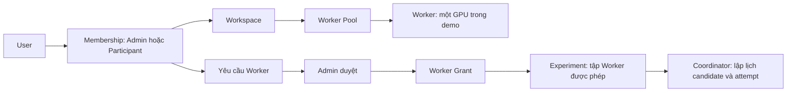
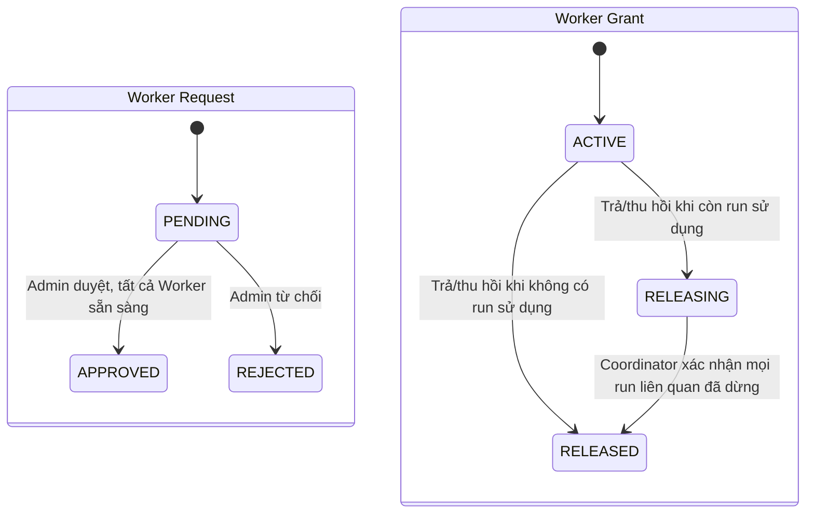
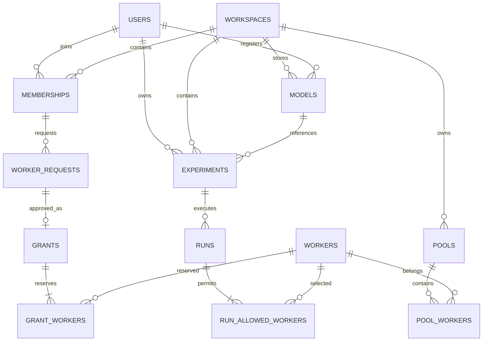
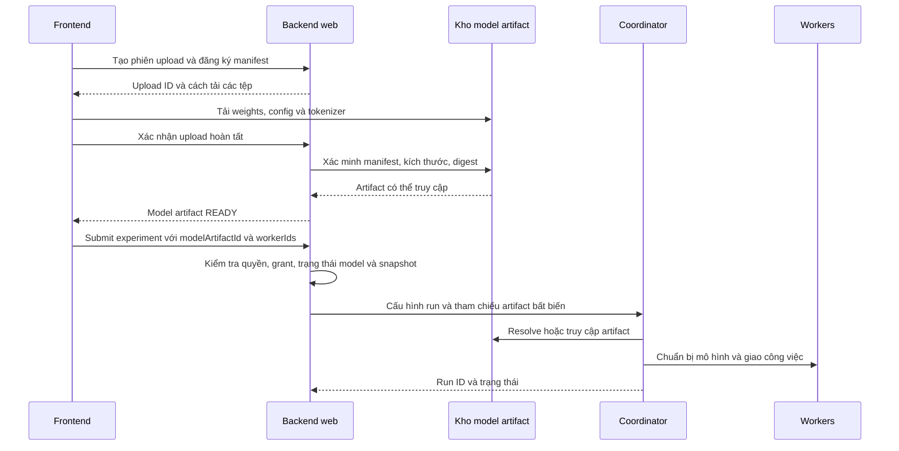

> Cập nhật 2026-10-09: thiết kế dưới đây là bản trước v1. Thiết kế mới có năm sidebar tabs,
> role theo workspace, Worker ownership, dataset splits và Pause/Resume.
> Tài liệu bàn giao v1: `/home/nguyennhutkhang/Public/Learning/Inclass/IT_Project/src/Hetero-ES-LLM/notes/chat_notes/docs/uncheck/README_v1.md`.
> Các quy tắc cũ “chỉ Admin được tạo workspace” và “Admin xem mọi experiment” đã được thay thế.

# HeteroES — bản demo local và hợp đồng bàn giao backend

- Phạm vi: đăng nhập, workspace, Worker Pool, cấp/thu hồi Worker, mô hình và experiment.
- Trạng thái: frontend + API giả lập bằng MSW; chưa có backend/database/Coordinator thật.
- Thiết kế Admin/Participant trong tài liệu này theo yêu cầu demo mới. Quyền Owner/Partner/Viewer trong notes cũ chưa được thay đổi hoặc chốt lại.
- Các endpoint, kiểu dữ liệu và trạng thái dưới đây là hợp đồng prototype để thảo luận với người làm backend.
- Dữ liệu GPU, model và runtime là dữ liệu mẫu, không phải kết quả đo hay bằng chứng tương thích mô hình.

## 1. Chạy và thử nghiệm

Chạy trong thư mục `frontend/` với dependency của dự án đã có:

```bash
npm run dev
```

Mở URL Vite hiển thị. Route đầu tiên là `/login`.

| Tài khoản mẫu | Vai trò | Mật khẩu công khai của demo |
|---|---|---|
| `admin` | Admin của GPU Lab và Private Lab; được tạo workspace | `demo-local` |
| `an` | Participant của GPU Lab | `demo-local` |
| `binh` | Participant của GPU Lab | `demo-local` |

MSW chỉ bật trong development. `npm run build` kiểm tra và tạo bundle; `npm run preview` không cung cấp API demo.

Các tài khoản cố định phục vụ trình diễn, không có đăng ký công khai. Không nhập mật khẩu hay mô hình riêng tư vào bản demo.

Snapshot nằm trong `localStorage` tại đúng key `heteroes.local-demo.v1`; phiên đang chọn nằm trong `sessionStorage`. Bản demo lưu token giả trong snapshot để mô phỏng kiểm tra và thu hồi phiên; đây không phải cách lưu credential production.

Mỗi request đọc lại snapshot. Trình duyệt hỗ trợ Web Locks sẽ tuần tự hóa truy cập giữa các tab cùng origin; trình duyệt khác dùng hàng đợi của từng tab. Backend thật phải thay cơ chế này bằng transaction/ràng buộc database. Nguồn về Web Locks: [MDN](https://developer.mozilla.org/en-US/docs/Web/API/Web_Locks_API).

Muốn bắt đầu lại, chỉ xóa key `heteroes.local-demo.v1`, `heteroes.demo-token` và `heteroes.demo-workspace` của website trong DevTools rồi tải lại. Không xóa toàn bộ storage của website nếu đang dùng các dữ liệu khác.

Kiểm tra tự động:

```bash
npm run lint
npm run build
node scripts/check-local-demo.mjs
```

Script kiểm tra dùng storage tạm trong bộ nhớ và MSW Node; không tác động snapshot của trình duyệt, không gửi request đến backend thật.

## 2. Mô hình workspace và quyền



| Hành động | Admin | Participant |
|---|---|---|
| Tạo workspace | Có quyền cấp tài khoản `canCreateWorkspace` | Không |
| Xem workspace | Chỉ workspace có membership | Chỉ workspace có membership |
| Thêm Participant đã tồn tại | Có, trong workspace của mình | Không |
| Tạo pool, thêm hoặc loại Worker | Có | Không |
| Xin Worker | Có, cho mình | Có, cho mình |
| Duyệt/từ chối yêu cầu Worker | Có | Không |
| Thu hồi grant | Có | Không |
| Trả grant | Chỉ grant của mình | Chỉ grant của mình |
| Xem experiment/model | Mọi tài nguyên trong workspace | Của mình trong workspace |
| Tạo, sửa draft, submit, archive experiment | Của mình | Của mình |
| Yêu cầu hủy run | Trong workspace | Run của mình |
| Xem audit | Toàn workspace | Thao tác của mình |

Admin trong một workspace không có quyền trong workspace khác khi thiếu membership. Backend xác định user từ phiên và xác định workspace thực của tài nguyên; không tin role/owner do client gửi.

Demo không có chức năng chỉnh role, khóa tài khoản hay bảo vệ Owner cuối. Đó là phần tiếp theo của service xác thực thật, cần thiết kế riêng.

## 3. Phân biệt các khái niệm Worker

| Khái niệm | Ý nghĩa |
|---|---|
| Registry | Worker đã được nhận diện bởi hệ thống. |
| Pool membership | Worker được đưa vào pool thuộc workspace nào. |
| Worker request | Người dùng xin những Worker cụ thể; chưa có quyền sử dụng. |
| Worker grant | Admin cấp quyền sử dụng cho một người dùng. |
| Runtime usage | Worker đang phục vụ một run đã được tiếp nhận. |
| Online/admission | Thông tin kỹ thuật do runtime đánh giá, độc lập với quyền cấp phát. |

Quy tắc của prototype:

- Một Worker thuộc tối đa một pool tại một thời điểm.
- Một Worker có tối đa một grant chưa RELEASED, kể cả giữa các workspace.
- Request chứa một nhóm Worker; duyệt toàn bộ hoặc từ chối toàn bộ, không cấp một phần.
- Grant cấp riêng cho user trong workspace; không phải lease của candidate.
- Người dùng chỉ chọn Worker trong grant ACTIVE, còn trong pool và không draining.
- Cấp quyền không cam kết Worker online hoặc chạy được một mô hình cụ thể.
- Khi submit, prototype kiểm tra Worker online, admission cho phép và chưa phục vụ run khác.
- Run kết thúc giải phóng runtime usage, nhưng grant vẫn thuộc user cho tới khi được trả/thu hồi.
- Trả/thu hồi grant khi busy sẽ xin hủy các run sử dụng nhóm đó và chờ xác nhận.
- Loại một Worker khỏi pool làm thu hồi cả grant group chứa nó; giao diện yêu cầu xác nhận trước thao tác.
- Loại khỏi pool không xóa máy vật lý, không tắt GPU và không tác động hệ điều hành.

Các monitoring fixture cũ được giữ để xem chi tiết generation/candidate/attempt. Chúng có trước mô hình cấp phát mới và có thể thể hiện các run dùng cùng Worker. Các rule chống trùng được áp dụng cho thao tác mới; fixture cũ không chứng minh scheduler đúng. Worker `wk-demo-free` là mẫu chưa cấp để thử luồng mới.

### Trạng thái request và grant



Trong demo, xác nhận bắt đầu đến sau khoảng 4,5 giây; xác nhận hủy sau khoảng 5 giây. Các timer chỉ ở MSW. Backend thật cần nhận trạng thái runtime chính thức và đối soát nếu mất kết nối.

## 4. Dữ liệu và quan hệ để backend thiết kế database

Các type prototype nằm trong `src/types/access.ts` và `src/types/experiment.ts`.



| Dữ liệu | Trường/quan hệ chính |
|---|---|
| User | `userId`, `username`, `displayName`; credential và session thật thiết kế riêng. |
| Membership | `userId`, `workspaceId`, `role`; duy nhất mỗi cặp user/workspace. |
| Pool | `poolId`, `workspaceId`, `name`; Worker membership tách bảng khi backend hiện thực. |
| WorkerRequest | User, workspace, pool, Worker được xin, reason, status, thời gian. |
| WorkerGrant | User, workspace, pool, Worker được cấp, status, thời gian, nguồn return/revoke. |
| ModelRegistration | Workspace, owner, source, revision hoặc danh sách metadata tệp. |
| Experiment | Workspace, owner, tên và cấu hình draft; model và Worker mong muốn. |
| Run | Snapshot bất biến của cấu hình; `runId` của Coordinator, trạng thái thực thi. |
| Audit | Workspace, actor lấy từ session, action, target, thời điểm, mã đối soát. |

ERD là mô hình đề xuất cho backend; không phải schema đã triển khai. Prototype lưu mảng JSON và dùng `experimentId` theo dõi một lần submit. Backend thật cần tách Run, chốt số lần chạy/experiment và quy tắc chạy lại.

Khi duyệt grant, backend phải khóa/ràng buộc trên Worker và kiểm tra lại membership, pool, trạng thái grant/usage trong một giao dịch. Hai Admin duyệt đồng thời không được cấp cùng Worker. Audit và thay đổi quyền cần cùng giao dịch hoặc cơ chế đảm bảo nhất quán tương đương.

Grant có trạng thái RELEASING vẫn giữ quyền đặt chỗ để không cấp trùng. Hủy được tiếp nhận chưa có nghĩa Worker có thể tái sử dụng.

## 5. API prototype

API service tập trung tại `src/api/access.ts` và `src/api/experiments.ts`.

Trong demo, request dùng `Authorization: Bearer <demoToken>` và `X-Workspace-Id`. Header workspace chọn phạm vi yêu cầu; handler vẫn kiểm tra membership và workspace của tài nguyên. Hợp đồng session production cần chốt lại; không dùng credential của mock cho production.

| Method / đường dẫn `/api/v1` | Nội dung |
|---|---|
| `POST /auth/login` | `{ username, password }` → user, workspaces, `demoToken`. |
| `GET /auth/session` | User và workspaces của phiên. |
| `POST /auth/logout` | Thu hồi token, trả 204. |
| `GET /workspaces` | Workspace theo membership. |
| `POST /workspaces` | `{ name }` → workspace mới, creator là Admin. |
| `POST /workspaces/{id}/members` | `{ username }` → thêm Participant đã tồn tại. |
| `GET /resources` | Pools, grants, requests, members, busy/reserved Worker IDs. |
| `POST /pools` | `{ name }` → pool mới trong workspace. |
| `GET /worker-registry` | Worker hiện không thuộc pool; dành cho Admin. |
| `POST /pools/{id}/workers` | `{ workerId }` → đưa Worker đã đăng ký vào pool. |
| `DELETE /pools/{id}/workers/{workerId}` | Loại hoặc bắt đầu draining; có thể trả 202. |
| `POST /worker-requests` | `{ poolId, workerIds, reason }` → PENDING. |
| `POST /worker-requests/{id}/decision` | `{ decision: APPROVE hoặc REJECT }`. |
| `POST /grants/{id}/return` | User trả grant của mình. |
| `POST /grants/{id}/revoke` | Admin thu hồi grant. |
| `GET /models` | Model metadata được phép xem. |
| `POST /models` | Đăng ký tham chiếu hoặc metadata tệp, chưa phải upload. |
| `GET /experiments` | Experiment được phép xem. |
| `GET /experiments/{id}` | Chi tiết experiment theo quyền. |
| `POST /experiments` | Tạo DRAFT với model và Worker đã cấp. |
| `PATCH /experiments/{id}` | Sửa cấu hình DRAFT của mình. |
| `DELETE /experiments/{id}` | Archive nếu không QUEUED/RUNNING; giữ dữ liệu lịch sử. |
| `POST /experiments/{id}/submit` | Kiểm tra lại quyền và Worker; trả QUEUED/202. |
| `POST /experiments/{id}/cancel` | Yêu cầu hủy; trạng thái thực thi giữ nguyên tới xác nhận. |
| `GET /audit` | Admin xem workspace; Participant xem thao tác của mình. |

Các endpoint `/demo/workers` và `/demo/experiments/{id}/complete` chỉ phục vụ mô phỏng. Không đưa vào hợp đồng runtime production.

API monitoring hiện có cho generations, candidates, attempts, events và artifacts được lọc theo quyền xem experiment/workspace. Thao tác archive không cho truy cập lại chi tiết qua những đường dẫn này.

Lỗi prototype có dạng `{ "message": "..." }` với 401, 403, 404, 409 hoặc 422. Backend cần chốt thêm mã lỗi ổn định, phân trang, mã request và hành vi mất kết nối.

## 6. Đưa LLM sang Coordinator

### Luồng tham chiếu mô hình

1. User đăng ký repository và revision.
2. Backend kiểm tra quyền, resolve revision thành phiên bản bất biến và ghi model artifact.
3. Coordinator/runtime tải hoặc dùng cache của phiên bản đó.

Hugging Face hỗ trợ tải snapshot theo `revision`, bao gồm commit hash; `snapshot_download` tải repository. Chọn full commit hash là đề xuất để cố định đầu vào experiment. [Hugging Face Hub](https://huggingface.co/docs/huggingface_hub/guides/download).

### Luồng upload mô hình



Backend thật nên chuyển tham chiếu model sang Coordinator thay vì nhét toàn bộ trọng số vào JSON submit. Kho lưu trữ phải được Coordinator/Workers truy cập bằng cơ chế đã thống nhất; một đường dẫn chỉ tồn tại trên máy chạy browser không đủ.

Upload phải bao phủ weights, config, tokenizer và index/shards khi có. Backend xác minh manifest, digest và format. Safetensors là định dạng lưu tensor; dùng được định dạng này không tự chứng minh mọi file/model tương thích runtime. [Safetensors](https://huggingface.co/docs/safetensors/index).

Trong bản demo hiện tại, `UPLOAD_METADATA` chỉ đọc tên/kích thước từ đối tượng File. Không đọc nội dung, không upload, không tính checksum, không download repository và không xác minh đầy đủ bộ model. `REGISTERED` không có nghĩa artifact đã READY.

Ví dụ hợp đồng dự kiến giữa backend và Coordinator:

```json
{
  "submissionId": "mã-chống-gửi-trùng",
  "experimentId": "mã-experiment",
  "workspaceId": "mã-workspace",
  "requestedBy": "user-id-xác-định-từ-phiên",
  "modelArtifactId": "artifact-bất-biến-đã-READY",
  "allowedWorkerIds": ["worker-a", "worker-b"],
  "configuration": {
    "task": "Countdown",
    "schedulerPolicy": "capacity-weighted",
    "syncMode": "synchronous"
  }
}
```

Đây là đề xuất cần thống nhất với backend/runtime. Coordinator phải thực thi giới hạn Worker được phép, không chỉ frontend lọc danh sách. Credential kho model không nằm trong request JSON hay audit.

## 7. Ranh giới lập lịch và kết nối

Frontend chọn tập Worker và hiển thị trạng thái; Backend kiểm tra quyền và quản lý cấp phát. Coordinator chọn candidate/attempt, admission, lease, retry và cập nhật model. Worker thực hiện tính toán.

Trang `/scheduling` hiển thị experiment → tập Worker được chọn, trạng thái online mẫu và policy. Các trang chi tiết candidate/attempt giữ thông tin monitoring mẫu. Prototype không thiết lập kết nối Worker–Worker, không kiểm tra mạng và không điều khiển Ray/PyTorch.

Chọn chính sách lập lịch là yêu cầu cấu hình; backend/runtime cần xác nhận các chính sách được hỗ trợ. Không mặc định cộng tổng VRAM của các GPU là đủ để nạp một LLM; runtime phải xác định cách nạp và khả năng từng Worker.

## 8. Kịch bản bàn giao

1. Đăng nhập `an`; mở Workspace, gửi yêu cầu `wk-demo-free` với lý do sử dụng.
2. Đăng xuất, đăng nhập `admin`; duyệt yêu cầu đó.
3. Đăng nhập lại `an`; kiểm tra grant ACTIVE. Đăng ký model metadata mới hoặc chọn mẫu của An.
4. Tạo experiment, chọn Worker vừa cấp, lưu DRAFT; sửa tên hoặc cấu hình.
5. Submit: QUEUED rồi RUNNING sau xác nhận giả lập. Thử submit lại hoặc sửa cấu hình đã gửi để thấy lỗi.
6. Mở Worker usage để thấy Worker của experiment. Dùng Simulate runtime completion: run kết thúc nhưng grant vẫn ACTIVE.
7. Participant trả Worker; kiểm tra RELEASED. Admin có thể cấp cho Bình.
8. Thử một run khác rồi trả/thu hồi khi QUEUED/RUNNING: grant ở RELEASING, Worker chưa được cấp lại, sau xác nhận thì CANCELLED và RELEASED.
9. Admin loại Worker khỏi pool, đưa Worker đã được giải phóng vào pool khác. Tạo workspace mới, thêm `an` hoặc `binh` và tạo pool.
10. Kiểm tra Participant không thấy experiment/model của người khác, không gọi được API Admin hoặc truy cập Private Lab nếu chưa được thêm.

## 9. Những gì backend cần chốt trước triển khai thật

- Phương thức xác thực, bảo vệ phiên và kiểm tra quyền giữa các service.
- Admin tạo workspace là quyền toàn ứng dụng hay có chính sách cấp riêng; role production dùng tên nào.
- Worker đại diện một GPU, một tiến trình hay nhiều GPU; định danh phần cứng và Worker registration thật.
- Cấp Worker độc quyền hay chia sẻ; thời hạn grant, quota và cách gia hạn.
- Quy tắc drain khi mất liên lạc với Coordinator; không giải phóng chỉ vì timeout.
- Archive experiment, số lần chạy/experiment và snapshot bất biến của Run.
- Idempotency và đối soát request submit khi mất kết nối.
- Kho artifact, upload/resume, xác minh đầy đủ model, revision và digest.
- Admission và các policy/runtime mode được hỗ trợ thực tế.
- Audit, thời gian lưu, phân trang, mã lỗi và hướng dẫn vận hành.

Các điểm này là giới hạn bàn giao, không phải chức năng backend đã hoàn thành.
